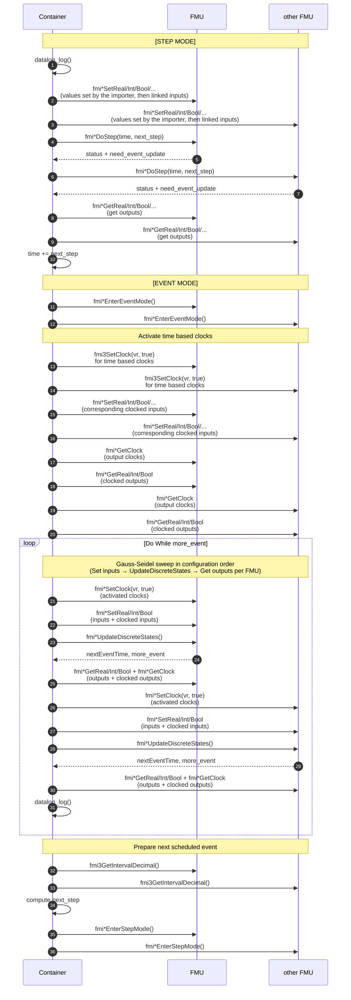

# FMI API Call Sequence during `container_do_step()`

> **Audience**: Developers working on the FMU Container C runtime.

This page documents the sequence of [FMI API](https://www.fmi-standard.org) calls that the
container performs on each embedded FMU during a single call to `container_do_step()`.

!!! info "Prerequisite"
    This page covers the **simulation loop**. For the sequence that brings the container up to
    `STEP_MODE` (instantiation and initialization), see the
    [Initialization FMI Sequence](init-fmi-sequence.md).

The container alternates between **STEP MODE** (continuous-time advancement via `fmi*DoStep`)
and **EVENT MODE** (discrete state updates and clock handling). The diagram below illustrates
the sequence for the **sequential** execution mode; the parallel modes (mono-thread and
multi-thread) follow the same logical order but interleave the `Set` / `DoStep` / `Get` phases
across all FMUs.

## Internal steps and communication step

`container_do_step(t, h)` makes every internal step `[T, T + H]` (`H` = `time_step` × `TS_MULTIPLIER`, the
multiplier read before each step) that ends before `t + h`, each one as in the diagram above. When an internal step
does not fit (communication step not a multiple of the internal step), it stays **pending**
(`container->step_pending`):

- when it becomes pending, every embedded FMU is synchronized with the values set until then (the inputs of `T`);
- while it is pending, the values set by the importer are **deferred** (state `CONTAINER_LINK_DEFERRED` of the
  links, `container_port_t.deferred` for the local variables); the outputs of the embedded FMU's, read by the
  getters, are those of `T`;
- the call of the importer that reaches `T + H` makes the step, then the deferred values become pending
  (`container_end_pending_step()`): the local variables (`TS_MULTIPLIER`, reset triggers) are written, the embedded
  FMU's get theirs at their next synchronization, for the following steps.

The container is at `t + h` after every call (`reals64[0]`, its time output).

## Values set by the importer

The setters of the container (`fmi2Set*`, `fmi3Set*`, except `fmi3SetClock`) do not call the embedded FMU's: they
write the **cache** of the port (`container_cache_*`) and mark its links (`container_port_set()`, state
`CONTAINER_LINK_PENDING` of `container_vr_t`, counter `nb_pending` of the FMU). A port linked to a local variable
writes it at once. An FMU gets the values marked for it when it is **synchronized** (`container_sync_fmu()`, one
`fmi*Set` per link, from the cache):

- before each of its steps, at the exit of the Initialization Mode and at the event iterations (`fmu_set_inputs`);
  in Continuous Time Mode, its real values only (`fmu_set_continuous_inputs`), as its links;
- before it is read by a getter of the container (read after write);
- in its Configuration Mode (its structural parameters only), before its `fmi2SetupExperiment` and after its reset,
  where all the cached values are marked again (they prevail over the start values).

A value refused by an FMU is reported by the call that synchronizes it (`fmi*DoStep`, `fmi*ExitInitializationMode`,
`fmi*Get*`...), not by `fmi*Set*`. In the multi-thread mode, the synchronization runs in the main thread
(`fmu_set_inputs`): the worker threads only run `fmi*DoStep`.

## Notes

- `fmu_set_inputs` / `fmu_get_outputs` in the C runtime expand into a series of typed FMI calls
  (`fmi2SetReal`, `fmi3SetFloat64`, `fmi3SetBoolean`, …) according to the ports declared in
  `fmu_io`.
- In the **multi-thread parallel** mode, `fmi*DoStep` is executed concurrently on each FMU via
  per-FMU worker threads, synchronized through `mutex_container` / `mutex_fmu`.
- The EVENT MODE phase is entered only when at least one FMU has reported
  `need_event_update`, or when clocks are declared in `clocks_list`.
- Inside the `more_event` loop, FMUs are updated with a **Gauss-Seidel sweep** in configuration
  order: each FMU is driven `Set inputs → fmi*UpdateDiscreteStates → Get outputs` before moving to
  the next one, so a value produced by FMU *i* reaches FMU *i+1* within the same pass and the
  outputs read back reflect the freshly updated discrete state.
- `fmi3GetIntervalDecimal()` is invoked only for FMUs that own scheduled clocks.
