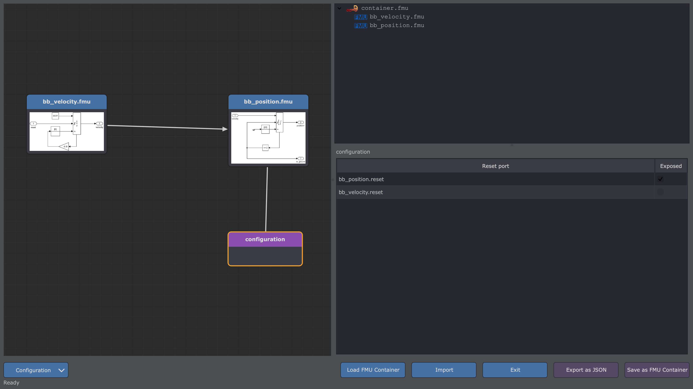

# Reset of Embedded FMUs

During a simulation, an embedded FMU sometimes has to start again from its initial state: a controller
re-armed by a supervisor, a component replaced on a test bench, a scenario restarted by an event... With
the option `reset_ports`, an FMU of the container (or the importer) can request the reset of another
embedded FMU.

## Principle

With `reset_ports`, each embedded FMU (sub-containers included) gets a reserved Boolean input,
`container.reset` (`fmi2Boolean` in an FMI-2 container, `fmi3Boolean` in an FMI-3 container). This input is
not a variable of the FMU: the container reads it.

When it is `true` at the start of an internal step of the container, the container:

1. writes a row in the [datalog](datalog.md), if any;
2. resets the FMU (`fmi2Reset` / `fmi3Reset`);
3. initializes it again **at the current time** of the container: start values, values set by the importer on
   its exposed inputs and parameters, current values of its inputs, then the event iteration;
4. runs the step;
5. writes `false` into the input at the end of the step.

The input is fed like any input of an embedded FMU:

- by a **link** from an output of another FMU (or of the same FMU);
- or **exposed** as an input of the container, named `container.<fmu>.reset` (`<fmu>`: name of the FMU,
  lowercase, without `.fmu`), by `auto_input` or by an explicit input rule.

A port neither linked nor exposed is reported by a warning at build time: the FMU is never reset.

!!! note "A pulse, not a level"
    The input goes back to `false` at the end of the step that reset the FMU, whoever set it to `true`. An FMU
    that keeps its output `true` resets the target **every other step**: to reset it once, the source must emit
    a pulse (`true` during one step).

## Same behavior in every mode

The reset is applied at the start of the next internal step, between two steps, in every execution mode
(parallel, multi-threaded, sequential): a request made by an FMU during the step `n` resets the target before
the step `n+1`. One link or one container input may reset several FMUs at once.

Co-Simulation and Model-Exchange FMUs are supported: the solver reads the states of a reset Model-Exchange FMU
again. A sub-container is reset with all its FMUs.

## Configuration

=== "Command line"

    ```bash
    fmucontainer -container assembly.json -reset-ports
    ```

    With the default `auto_input`, every reset input is exposed by the container.

=== "JSON"

    ```json
    {
      "name": "resettable.fmu",
      "reset_ports": true,
      "fmu": ["supervisor.fmu", "controller.fmu"],
      "link": [["supervisor.fmu", "restart", "controller.fmu", "container.reset"]]
    }
    ```

    An exposed reset input is an `input` rule: `["container.controller.reset", "controller.fmu",
    "container.reset"]`.

=== "CSV"

    The option is given by the command line (`-reset-ports`); the link is a regular `LINK` rule:

    ```
    LINK;supervisor.fmu;restart;controller.fmu;container.reset
    ```

=== "Python"

    ```python
    from fmu_manipulation_toolbox.container import FMUContainer

    container = FMUContainer("resettable", "fmus", reset_ports=True)
    container.get_fmu("supervisor.fmu")
    container.get_fmu("controller.fmu")
    container.add_link("supervisor.fmu", "restart", "controller.fmu", "container.reset")
    container.add_input("", "supervisor.fmu", "container.reset")    # exposed as container.supervisor.reset
    container.make_fmu("resettable.fmu")
    ```

    `reset_ports` is a parameter of the constructor: the ports exist as soon as the FMUs are loaded.

The source may be of any type that converts to a Boolean (e.g. a `Real` is `true` when it is not `0`), as for
any link. A start value cannot be set on `container.reset`.

## Container Builder

In the [FMU Container Builder](gui-usage.md), check `reset_ports` in the *Container Details* panel (the root
container included): the [`configuration` node](gui-usage.md#the-configuration-node) gets one
`<fmu>.reset` port per FMU, or sub-container, of that container. Wire an FMU to it, and select the node to expose
reset ports as inputs of the container.



## The container itself

`fmi2Reset` / `fmi3Reset` of a container are supported: every embedded FMU is reset, and the container goes back
to its state after instantiation (its datalog goes on in the same file).

## Datalog

The datalog writes one row just before the reset, at the same time as the row of the previous step:

- for an exposed input, its value is `1` in this row only;
- for a link, the datalog shows the link variable, i.e. the value of the source before its conversion to a
  Boolean: the reset is visible by the repeated time.

## Limitations

- `container.reset` is a reserved name: an FMU with a real port of this name cannot be embedded with
  `reset_ports` (the build stops with an error). A real port named `reset` is not concerned.
- Exposed without explicit name (`auto_input`, or an input rule with an empty name), the reset input is named
  `container.<fmu>.reset`: the build stops with an error if the container already has a variable of this name
  (e.g. an input of a sub-container): give the input another name explicitly. An explicit name may feed several
  reset ports, to reset several FMUs at once.

- The reset of an FMU whose clocks are scheduled by the container (LS-BUS, `countdown` clocks) is not supported:
  the step fails with an error.
- The embedded FMU must support `fmi2Reset` / `fmi3Reset`, and an initialization at a start time other than the
  start of the simulation: if the reset fails, the step fails with an error.
- `fmusplit` restores the option `reset_ports` only when at least one reset input is linked or exposed: without
  it, nothing in the container tells the option (which then has no effect on the simulation).
