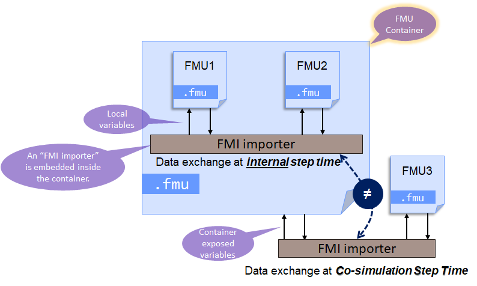
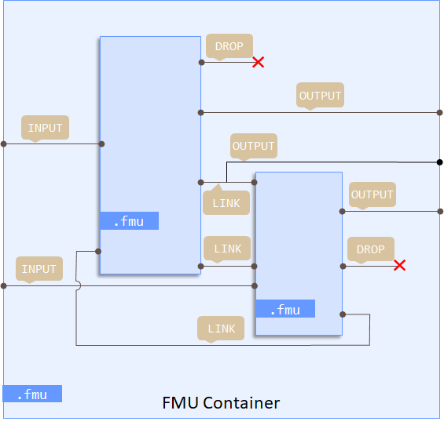
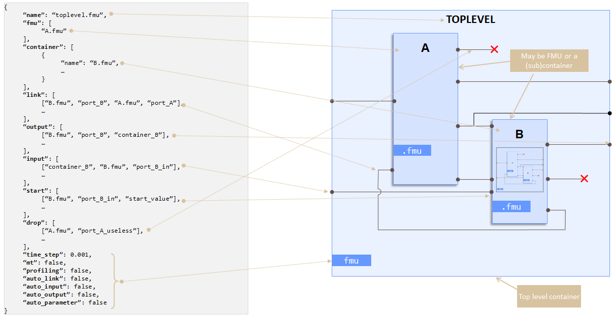

# FMU Containers

An FMU Container is a classical FMU which embeds other FMU's:



From API point of view, an FMUContainer can be seen as
* an FMU which implements the FMI API (either version 2.0 or 3.0)
* an fmi-importer which can load FMUs

FMU Manipulation Toolbox is shipped with `fmucontainer` command which makes it easy to nest FMU's into FMU.

!!! tip "Video Presentation"
    A video presentation of FMU Containers is available on YouTube:
    :fontawesome-brands-youtube:{ style="color: #EE0F0F" } [FMU Container Presentation](https://www.youtube.com/watch?v=CAjS3oH3QNI){ target="_blank" }


# How to create an FMU Container ?

The `fmucontainer` command creates a FMU, named Container, from a description file. This file contains multiple parameters:

- *time_step*: a FMU Container acts as a fixed step time "solver" for its embedded FMU's. For
  [Model-Exchange](#model-exchange-support) FMU's, this time step is also used as the integration
  step of the built-in solver. When it is not given, it is deduced from the embedded FMU's (see
  [Default time step](#default-time-step)).
- optional features
  - *multi-threading*: the embedded FMU's whose `doStep()` is long enough are stepped by worker threads, in
    parallel (see [Multi-Threading](#multi-threading)).
  - *profiling*: performance indicators can be calculated by the container to help to identify the bottlenecks among 
    the embedded FMU's.
  - *reset_ports*: each embedded FMU gets a `container.reset` input; when it is true, the container resets the FMU
    during the simulation (see [Reset of Embedded FMUs](container-reset.md)).
- routing table
  - Input ports: the list of the Container's inputs. Each input is linked to one input (or more) of one of the embedded FMU's.
  - Output ports: the list of the container's outputs. Each output is linked to one output of one of the embedded FMU's.
  - Connections between embedded FMU's. When the types differ, the value is converted (lossy conversions, such as
    `Float64` to `Float32` or a number to a boolean, are reported by a warning).

  Each input of an embedded FMU is fed by **one** source: a container input or a connection, not both, and not
  two connections. An output can be exposed and connected at the same time. Every port named in the routing table
  must exist: an unknown FMU or port stops the build with an error.
  - Explicitly ignored ports (only port with `causality = "output"` can be ignored)
- Automation of routing table
  - *auto_input* exposes automatically the (unconnected) ports of embedded FMU's with `causality = "input"`
  - *auto_output* expose automatically the (unconnected) ports of embedded FMU's with `causality = "output"`
  - *auto_local* expose automatically the ports of embedded FMU's with `causality = "local"`
  - *auto_parameter* expose automatically the ports of embedded FMU's with `causality = "parameter"`
  - *auto_link* links automatically ports of embedded FMU's which are left previously unconnected and have the same
    names and types. The [instances](#embedding-the-same-fmu-several-times) of an FMU are never auto-linked: they
    share the port names of the FMU, so an output would feed the inputs of every instance.

  When *auto_input* or *auto_output* exposes a port whose name is already used by an input or an output of the
  container, the port is exposed as `<fmu>.<port>` instead (e.g. `bb_position-1.position1`), so that every
  variable of the container keeps a distinct name.

  Clocks and clocked variables (attribute `clocks`) are never exposed: the container has no clocked partition on its
  interface. Exposing one explicitly (JSON, SSP, API) is reported as an error and the port is left out, the build goes
  on; *auto_input*, *auto_output* and *auto_local* leave them out (a warning is issued for the inputs and the
  outputs). They can only be linked between embedded FMUs.
  A time-based input clock (`intervalVariability` `constant`, `fixed`, `tunable`, `changing` or `countdown`) that is
  not linked is scheduled by the container, from its interval and shift: its first tick is at the start time plus its
  shift (FMI 3.0, 2.2.8.2). A `triggered` input clock that is not linked never ticks.
  The clocked variables are not exchanged in the Initialization Mode: FMI 3.0 allows it (2.2.7.2), but many FMUs refuse
  it. The local variable of a link between clocked variables keeps 0 (or empty) until the first tick of its clock, and
  the clocked input it feeds keeps its own start value meanwhile; the datalog shows these values.

Some of these parameters can be defined by Command Line Interface or by the input files.

To rebuild as a container an assembly of FMUs made in Simulink, see
[From Simulink to an FMU Container](../../examples/simulink-to-container.md).

## Default time step

When no time step is given, the container deduces it from the `stepSize` of the embedded FMU's
(`<DefaultExperiment>` of their `modelDescription.xml`):

- the FMU's which cannot handle a variable communication step size impose their step: the container step is
  their **least common multiple**, computed exactly (`0.1` and `0.25` give `0.5`, `0.2` and `0.3` give `0.6`);
- if all FMU's handle a variable step size, the container step is the largest of their step sizes;
- FMU's without `stepSize` are ignored; if none declares one, the step is `0.1` second.

When the time step is given, a warning is reported for each FMU with a fixed step that does not divide it.

## Communication step and internal step

The importer of a container (a simulation tool, or the parent of a nested container) calls it with its own
*communication step* `h`; the container steps its embedded FMU's with its *internal step* `H` (its time step,
times the `TS_MULTIPLIER` input when [enabled](container-vr.md)). When `h` is not a multiple of `H` — for instance a
parent at 0.01 s and a sub-container at 0.02 s — the container behaves like an FMU with a fixed internal step:

- each internal step `[T, T + H]` uses the **inputs of its beginning** `T`: the values set by the importer during
  the step are kept for the following steps;
- its **outputs are held** until the end `T + H` of the step;
- the internal step is made by the call of the importer that reaches its end, and the container is at the end of
  every communication step.

This makes it possible to gather FMU's of different rates in sub-containers of different steps, the parent at the
fastest rate (see [One sub-container per sample time](../../examples/simulink-to-container.md#one-sub-container-per-sample-time)).

## Termination requested by an embedded FMU

When an embedded FMU asks to terminate the simulation (`terminateSimulation` of FMI 3.0, or `fmi2Discard` with
`fmi2Terminated` of FMI 2.0), the container stops at the time reached and tells its importer:

- FMI 3.0 container: `fmi3DoStep` returns `terminateSimulation = true`, with the time reached in `lastSuccessfulTime`;
- FMI 2.0 container: `fmi2DoStep` returns `fmi2Discard`, then `fmi2GetBooleanStatus(fmi2Terminated)` is true and
  `fmi2GetRealStatus(fmi2LastSuccessfulTime)` gives the time reached.

The time reached is the end of the internal step of the container in which the request came, even when the FMU
that asked to terminate did not complete this step (FMI 2.0 `fmi2Discard`): it is the time of the other embedded
FMUs and of the outputs read by the importer. The rest of the communication step is not done, and a further step is
refused: the importer ends the simulation.

## Sequential mode

With the `sequential` option (`-sequential` on the command line), the Co-Simulation FMU's step one after the
other in the order of the description, each one with the outputs just computed by the FMU's before it; the
Model-Exchange FMU's step together after them. An FMU placed before an FMU it depends on gets the outputs of the
previous step. When the order of the description does not match the order of the links between the Co-Simulation
FMU's, the build reports a warning with the topological order of these FMU's:

```
Sequential mode: the order of the configuration does not match the topological order of the links. Topological order of the Co-Simulation FMUs: A.fmu, B.fmu, C.fmu.
```

Reorder the FMU's of the description to follow it. The links inside a loop (`A → B → A`) are not taken into
account: one of them goes backwards whatever the order.

## Initialization of the embedded FMU's

During the initialization, the container **propagates the links** between its embedded FMU's, as Simulink does:
each FMU is initialized with the values computed by the FMU's it depends on. When the container leaves its
*Initialization Mode*, it takes its FMU's in the order of their links: each FMU gets its linked inputs, leaves its
*Initialization Mode*, then its outputs are read for the FMU's after it. In a chain `A → B → C`, `B` is
initialized with the outputs of `A`, then `C` with the outputs of `B`.

- **Loops of links** (`A → B → A`): a loop is cut before its first FMU in the description, which is initialized
  with the value the link has before the propagation; the build reports a warning.
- **Outputs read during the initialization**: an importer that reads an output of the container before the end of
  its initialization gets the value of the embedded FMU, not propagated yet: the propagation happens when the
  container leaves its *Initialization Mode*. A nested container propagates its own links.
- Clocks and clocked variables (LS-BUS) are not propagated: they are handled once the FMU's leave the
  initialization.
- The [reset of an embedded FMU](container-reset.md) initializes it again with the current values of its inputs,
  without propagation to the other FMU's.
- The start values, then the values set by the importer of the container, are set **before** `fmi2SetupExperiment`
  of an FMI 2.0 FMU (an FMU may use its parameters there, as the XCP service of
  [FMI-LS-XCP](ls-xcp.md#configuration-mode)): the values set by the importer prevail over the start values.
- The structural parameters exposed by the container are set in the *Configuration Mode* of their FMU, see
  [FMI-LS-XCP](ls-xcp.md#configuration-mode).
- A value set on the container (`fmi*Set*`) is kept by the container and given to the embedded FMU when it needs it:
  before its next step, when it leaves its *Initialization Mode*, or when one of its variables is read. If the
  embedded FMU refuses the value, the error is reported by that call, not by `fmi*Set*`.

The FMI calls are detailed in [Initialization FMI Sequence](../../developer/init-fmi-sequence.md).

Several formats are supported as description files:
- a `CSV` format: define only the routing table. Other options should be defined as command line options.
- a `JSON` file: all parameters can be defined in the file. Command line can define default values if the parameter 
  is not present in `JSON` file.
- a `SSP` file. See [ssp-standard.org](https://ssp-standard.org). define only the routing table. Other options are defined with command line.

## Command Line Options

The `fmucontainer` command supports the following options:

| Option                              | Default        | Description                                                                                                                                                                                                                          |
|-------------------------------------|----------------|--------------------------------------------------------------------------------------------------------------------------------------------------------------------------------------------------------------------------------------|
| `-container filename[:step_size]`   | *(required)*   | Description file for the container (`.csv`, `.json`, or `.ssp`). The optional `:step_size` suffix sets the internal time step (in seconds) when using `.json`or `.ssp`. Can be specified multiple times to build several containers. |
| `-fmu-directory path`               | `.`            | Directory containing the source FMUs and used to generate the containers.                                                                                                                                                            |
| `-fmi {2\|3}`                       | `2`            | FMI version for the container interface. Only `2` or `3` is supported.                                                                                                                                                               |
| `-mt`                               | off            | Enable multi-threaded mode: the embedded FMUs whose step is long enough run on worker threads. See [Multi-Threading](#multi-threading).                                                                                             |
| `-mt-threshold seconds`             | `5e-05`        | Multi-threaded mode: an embedded FMU gets a thread when its mean `doStep()` takes at least this duration, measured over the first 20 steps.                                                                                       |
| `-sequential`                       | off            | Use sequential mode to schedule embedded FMUs.                                                                                                                                                                                       |
| `-profile`                          | off            | Enable profiling mode to monitor `doStep()` performance of each embedded FMU.                                                                                                                                                        |
| `-vr`                               | off            | Add a `TS_MULTIPLIER` input port to the container, allowing dynamic control of the step size.                                                                                                                                        |
| `-reset-ports`                      | off            | Add a `container.reset` input to each embedded FMU, to reset it during the simulation. See [Reset of Embedded FMUs](container-reset.md).                                                                                            |
| `-datalog`                          | off            | Log input, output, and local variables of the container into a CSV file.                                                                                                                                                             |
| `-dump-json` (or `-dump`)           | off            | Dump a JSON description file for each container (`<input>-dump.json`).                                                                                                                                                               |
| `-dump-ssp`                         | off            | Dump an SSP file for each container (`<input>-dump.ssp`): see [SSP export](#ssp-export).                                                                                                                                             |
| `-no-auto-input`                    | auto           | Disable automatic exposure of unconnected input ports from embedded FMUs.                                                                                                                                                            |
| `-no-auto-output`                   | auto           | Disable automatic exposure of unconnected output ports from embedded FMUs.                                                                                                                                                           |
| `-no-auto-link`                     | auto           | Disable automatic linking of ports with matching names and types.                                                                                                                                                                    |
| `-auto-local`                       | off            | Expose local variables of the embedded FMUs.                                                                                                                                                                                         |
| `-auto-parameter`                   | off            | Expose parameters of the embedded FMUs.                                                                                                                                                                                              |
| `-debug`                            | off            | Enable verbose logging during the build process, and keep the build directory (`<container name>/` in the FMU directory).                                                                                                             |

**Example:**

```bash
fmucontainer -container assembly.csv:0.001 -fmu-directory ./my_fmus -fmi 3 -mt -profile
```

This command builds an FMI-3.0 container from `assembly.csv` with a 1 ms time step, multi-threading enabled,
and profiling active. The source FMUs are located in the `./my_fmus` directory.



## CSV Input file
This is the historic input file format. It has been superseded by the Json input file format. It cannot describe
an FMU [embedded several times](#embedding-the-same-fmu-several-times): exporting such an assembly to CSV is
refused.

Example: 
  * Two FMU's to be assembled: `bb_position.fmu` and `bb_velocity.fmu`
  * Container should expose `position1` from `bb_position.fmu` as `position`
  * Container has no input
  * there's two links between embedded FMU's


the `container.csv` file content:

```csv
rule;from_fmu;from_port;to_fmu;to_port
FMU;bb_position.fmu;;;
FMU;bb_velocity.fmu;;;
OUTPUT;bb_position.fmu;position1;;position
LINK;bb_position.fmu;is_ground;bb_velocity.fmu;reset
LINK;bb_velocity.fmu;velocity;bb_position.fmu;velocity
OUTPUT;bb_velocity.fmu;velocity;;
```

Asserting the FMU's and the CSV files are located in current working directory,
the following command will build the container:

```
fmucontainer -container container.csv:0.1
```

Then `container.fmu` should be available.
Note: the optional `:0.1` suffix means the timestep should be `0.1` second.  

## Json Input file



```
fmucontainer -container container.json
```

The options of a container are keys of its JSON object: `step_size`, `mt`, `profiling`, `sequential`, `auto_link`,
`auto_input`, `auto_output`, `auto_parameter`, `auto_local`, `ts_multiplier`, `reset_ports`, and `mt_threshold`
(seconds, see [Multi-Threading](#multi-threading)), written by `-dump` only when it is not the default.

### Embedding the same FMU several times

Each embedded FMU is designated by its name in the `link`, `input`, `output`, `start` and `drop` blocks. Usually,
the name is the path of the FMU file. To embed the same FMU several times in one container, give each instance its
own name, and its file in the optional `path` block:

```json
{
  "name": "two_balls.fmu",
  "fmu": ["bb_position.fmu", "bb_velocity.fmu", "bb_position-1.fmu", "bb_velocity-1.fmu"],
  "path": {"bb_position-1.fmu": "bb_position.fmu", "bb_velocity-1.fmu": "bb_velocity.fmu"},
  "link": [["bb_position.fmu", "is_ground", "bb_velocity.fmu", "reset"],
           ["bb_velocity.fmu", "velocity", "bb_position.fmu", "velocity"],
           ["bb_position-1.fmu", "is_ground", "bb_velocity-1.fmu", "reset"],
           ["bb_velocity-1.fmu", "velocity", "bb_position-1.fmu", "velocity"]],
  "output": [["bb_position.fmu", "position1", "position"],
             ["bb_position-1.fmu", "position1", "position_2"]]
}
```

- The `path` block maps an instance name to its FMU file; a name absent from it is its own file. It is written
  only when the assembly has instances, so other descriptions are unchanged.
- The tools name the instances `<stem>-<n>.fmu` (`bb_position-1.fmu`, `bb_position-2.fmu`...), with the smallest
  free `n`; any name unique in its container is accepted.
- Each instance is a distinct embedded FMU: it is extracted in its own directory of the container, its library is
  loaded from there, and it is instantiated under its own name (`<container instance>.<instance name>`).
- `fmusplit` writes one FMU file per instance (`bb_position.fmu`, `bb_position-1.fmu`...), so the JSON it produces
  needs no `path` block.

## SSP Input file

SSP files are read, and written (see [SSP export](#ssp-export)). What the container cannot honour is refused or
reported, never ignored silently (see below).

The following command 
```
fmucontainer -container my_file.ssp:0.1
```

will generate an FMU container :  

1. extract FMU's from the SSP file
2. build a container accordingly to the SSP

Note: the optional `:0.1` suffix means the timestep should be `0.1` second. SSP has no step size of its own: without
the suffix, it is derived from the embedded FMUs, as for any container.

SSP 1.0 and SSP 2.0 files are read (both versions share the same XML namespace).

- **FMU names**: each component is embedded under its own name, `<component name>.fmu`. Several components may share
  one FMU source: each of them is an [instance](#embedding-the-same-fmu-several-times) of that FMU.
- **FMU files**: the FMUs are extracted keeping their path inside the archive (`resources/...`), so two FMUs with
  the same file name in different directories are both kept. A `source` outside the archive (absolute path, or
  `..`) is refused.
- **Systems**: a system inside a system becomes a nested container.
- **Connections**: a connection between two components is a link; a connection between a connector of the system
  and a component exposes an input (an input or a parameter of the FMU) or an output of the container. Each
  connection is checked against the FMUs: the connector must be a variable of the FMU (or an FMI 3.0 alias), of a
  causality that fits its end. A connector of the system that no connection uses is not exposed.
- **Components without `source`**: SSP 2.0 allows a component without implementation. Such a component is
  ignored, with a warning, together with the connections, wires and parameter values attached to it: an assembly
  whose FMUs are not all available can still be opened.
- **Geometry**: the [Container Builder](gui-usage.md#importing-an-assembly-file) places the nodes after the
  `ElementGeometry` of their components. The geometry takes no part in the container.

### Parameter values

The values of the `ParameterBindings` of components and systems become **start values** of the variables of the
embedded FMUs, as the `start` block of a [JSON description](#json-input-file); the parameters are not exposed for
all that (use `auto_parameter` for that).

- **Sources**: values inline (`ssv:ParameterSet` in `ParameterValues`), an `.ssv` file of the archive, or an `.ssv`
  file inside the FMU of the component (`sourceBase="component"`). A source outside the archive, or of another type
  than `application/x-ssp-parameter-set`, is refused.
- **Names**: on a component, the name of a variable of its FMU. On a system, the name of one of its connectors —
  the value goes, through the connections, to the FMU variables connected to it — or a hierarchical name,
  `element.variable` (`sub.engine.k` through a sub-system). The `prefix` of a binding is prepended to the names of
  its source.
- **Priority**, as in the SSP standard: a later binding overrides an earlier one of the same element, and the
  bindings of a system override those of its elements.
- **Values**: `Real`/`Float32`/`Float64`, integers, `Boolean`, `String`, and `Enumeration`, given by the name of
  its item and converted with the type definition of the FMU.
- A name that matches no variable is ignored, with a warning. A value for a variable that cannot be parameterized
  (a constant, or a variable computed by the FMU: neither an input nor an `initial` `exact` or `approx`) is
  refused, as a binary value or a value in another unit than its variable.

### Default experiment

The `startTime` and `stopTime` of the `DefaultExperiment` of the SSP become those of the default experiment of the
container. They are not part of the JSON description, nor kept by the Container Builder.

### Refused constructions

The container cannot apply these SSP constructions, which change the values exchanged: reading the file fails with
a message naming the element.

| Construction | Why |
|---|---|
| Component of another `type` than an FMU (`application/x-ssp-definition`, `application/x-ssp-package`) | Only FMUs are embedded |
| Connection transformation (`LinearTransformation`, `BooleanMappingTransformation`, `IntegerMappingTransformation`, `EnumerationMappingTransformation`) | The container does not transform the values it routes |
| `ParameterMapping` | It renames and may transform the parameter values |
| Connection through a `SignalDictionaryReference` | Signal dictionaries are not supported |
| Connected connectors of different units (unless `suppressUnitConversion="true"`) | SSP implies a unit conversion; units with the same definition in `ssc:Units` are the same unit |

A signal dictionary that no connection uses changes nothing: it is only reported with a warning.

### Validation

`SystemStructure.ssd` is validated against the SSP 2.0.1 schema (which also accepts SSP 1.0 files). Each validation
error is a warning, and the file is read if the reader understands it.

### SSP export

An assembly is written as an SSP file by `fmucontainer -dump-ssp`, by **Save** (SSP) in the
[Container Builder](gui-usage.md#actions), or by `Assembly.write_ssp()`. The file is read back into the same
container, and other tools see the whole system.

- **Systems and components**: each container is a system, each embedded FMU a component named after its file
  (without `.fmu`). The FMUs are copied into the archive under `resources/`; components sharing one FMU (instances)
  share one file.
- **Routing resolved**: the links and exposed ports added by `auto_link`, `auto_input`, `auto_output`,
  `auto_parameter` and `auto_local` are computed (without building) and written as connections, like the explicit
  ones. A sub-container is resolved first. The FMUs must therefore be readable when exporting.
- **Connectors**: the variables used by the routing and the start values, with their kind, their type and their
  unit. A connection between different units carries `suppressUnitConversion="true"`: the container does not
  convert.
- **Start values**: a `ParameterBindings` with an inline parameter set on each component.
- **Architecture wires** and **geometry** (the positions of the nodes in the Container Builder).
- **Start and stop times**: in `DefaultExperiment`.
- **Options of each container**, and its dropped ports, in an annotation of its system — SSP has no step size:

```xml
<ssd:Annotations>
  <ssc:Annotation type="fmu_manipulation_toolbox.container">
    <fc:Container xmlns:fc="urn:fmu_manipulation_toolbox:container:1" formatVersion="1"
                  stepSize="0.01" mt="false" profiling="false" sequential="false"
                  autoLink="false" autoInput="false" autoOutput="false" autoParameter="false" autoLocal="false"
                  tsMultiplier="false" resetPorts="false">
      <fc:Drop element="bb_position" connector="position1"/>
    </fc:Container>
  </ssc:Annotation>
</ssd:Annotations>
```

The `auto*` options are written `false`, the routing being explicit. When the file is read, the options of the
annotation **prevail** over those of the command line (a message says so); a file without annotation takes the
command line.

SSP 2.0 is written by default; `Assembly.write_ssp(filename, ssp_version="1.0")` writes SSP 1.0, the FMI 3.0 types
being written as FMI 2.0 ones (`Real`, `Integer`).

```python
from pathlib import Path
from fmu_manipulation_toolbox.assembly import Assembly

assembly = Assembly("bouncing.json", fmu_directory=Path("my_fmus"))
assembly.write_ssp("bouncing.ssp")   # relative to fmu_directory, as write_json
```

### Architecture wires

An SSP file may describe a system at the architecture stage, before the exchanged variables are known: an
*architecture wire* says that a component feeds another one (or both ways, or without direction), with a free text
comment. It is written as a regular `ssd:Connection` between two synthetic connectors, carrying an annotation of
type `fmu_manipulation_toolbox.architecture-wire`:

```xml
<ssd:Connection startElement="Engine" startConnector="aw.Gearbox"
                endElement="Gearbox" endConnector="aw.Engine"
                description="Torque and speed sent to the gearbox.">
  <ssd:Annotations>
    <ssc:Annotation type="fmu_manipulation_toolbox.architecture-wire">
      <aw:Wire xmlns:aw="urn:fmu_manipulation_toolbox:architecture-wire:1"
               formatVersion="1" orientation="directed"/>
    </ssc:Annotation>
  </ssd:Annotations>
</ssd:Connection>
```

| Item | Convention |
|---|---|
| Connectors | One synthetic connector on each component, recommended name `aw.<peer component name>`. Kind `output` (start side) and `input` (end side) for a directed wire, `unspecified` otherwise. |
| `orientation` | `directed` (from `startElement` to `endElement`), `bidirectional` or `undirected`. An unknown value is read as `undirected`, with a warning. |
| `description` | Optional comment of the wire, in Markdown (new lines written `&#10;`). |
| `formatVersion` | Version of the convention, currently `1`. |

An architecture wire is **not a link**: it takes no part in the container, it is not written in the JSON
description (nor in the one written by `fmucontainer -dump-json`), but it is kept by the [SSP export](#ssp-export). The Container Builder shows it as a hint
while you define the links (see [Wire Details](gui-usage.md#architecture-wires)).

# Python API

FMU Containers can also be created programmatically using the Python API. This is the most flexible approach
for automation and CI/CD pipelines.

## Using a Description File

The `Assembly` class can load an existing description file (CSV, JSON, or SSP) and build the container:

```python
from pathlib import Path
from fmu_manipulation_toolbox.assembly import Assembly

# Load a CSV description and build the container
assembly = Assembly("bouncing.json",
                    fmu_directory=Path("containers/bouncing_ball"),
                    default_mt=True)
assembly.make_fmu()
```

You can also export the assembly to a different format:

```python
# Export the assembly as JSON (useful for review or version control)
# FMU paths (fmu, link, input, output, start, drop blocks) are automatically
# made relative to the directory of "bouncing.json".
assembly.write_json("bouncing.json")

# Export back to CSV
assembly.write_csv("bouncing-export.csv")
```

!!! tip "Basename-only export"
    Pass `basenames_only=True` to `write_json()` to reference embedded FMUs only by their
    filename (no directory) instead of a path relative to the JSON's location. This is useful
    when the JSON's own physical location has no lasting meaning (e.g. a documentation copy
    written to a temporary directory before being embedded inside a built FMU).

## Building a Container Programmatically

For full control without any description file, use the `FMUContainer` class directly.
The following example builds a bouncing ball container from scratch:

```python
from pathlib import Path
from fmu_manipulation_toolbox.container import FMUContainer

fmu_directory = Path("containers/bouncing_ball")

# Create the container
container = FMUContainer("bouncing", fmu_directory, fmi_version=2)

# Load the embedded FMUs
container.get_fmu("bb_position.fmu")
container.get_fmu("bb_velocity.fmu")

# Expose outputs: (from_fmu, from_port, exposed_name)
container.add_output("bb_position.fmu", "position1", "position")
container.add_output("bb_velocity.fmu", "velocity", "velocity")

# Create links between embedded FMUs
container.add_link("bb_position.fmu", "is_ground", "bb_velocity.fmu", "reset")
container.add_link("bb_velocity.fmu", "velocity", "bb_position.fmu", "velocity")

# Automatically expose remaining unconnected inputs/outputs
container.add_implicit_rule(auto_input=True, auto_output=True, auto_link=True)

# Build the FMU container
container.make_fmu("bouncing.fmu", step_size=0.1, mt=True)
```

The resulting `bouncing.fmu` is generated in the `fmu_directory`. The container is assembled in the
directory `fmu_directory/<container name without .fmu>` (`bouncing/` here), which is **deleted** after the build,
unless `debug=True`: make sure no directory of yours has that name. `make_fmu` can be called several times on the
same `FMUContainer`, e.g. to build several variants.

The methods defining the topology raise `FMUContainerError` when a rule cannot be applied: unknown FMU or port,
wrong causality, incompatible types or dimensions, input already fed, start value of the wrong format.

## FMUContainer Reference

The `FMUContainer` constructor takes the following parameters:

| Parameter | Default | Description                                           |
|-----------|---------|-------------------------------------------------------|
| `identifier` | *(required)* | used as `modelIdentifier` in `modelDescription.xml`   |
| `fmu_directory` | *(required)* | Directory containing the source FMUs                  |
| `fmi_version` | `2` | FMI version for the container interface (`2` or `3`)  |
| `reset_ports` | `False` | Add a `container.reset` input to each embedded FMU (see [Reset of Embedded FMUs](container-reset.md)) |

The following methods define the container topology:

| Method | Description |
|--------|-------------|
| `get_fmu(fmu_filename, name=None)` | Load an embedded FMU from `fmu_directory`; `name` designates an [instance](#embedding-the-same-fmu-several-times) of an FMU embedded several times (e.g. `get_fmu("model.fmu", "model-1.fmu")`), then used by the other methods |
| `add_input(exposed_name, fmu_name, port_name)` | Expose a port of an embedded FMU as a container input |
| `add_output(fmu_name, port_name, exposed_name)` | Expose a port of an embedded FMU as a container output |
| `add_link(from_fmu, from_port, to_fmu, to_port)` | Connect an output to an input between embedded FMUs |
| `drop_port(fmu_name, port_name)` | Explicitly ignore an output port |
| `add_start_value(fmu_name, port_name, value)` | Set a start value for a port of an embedded FMU |
| `add_implicit_rule(auto_input, auto_output, auto_link, auto_parameter, auto_local)` | Automatically wire unconnected ports |
| `make_fmu(filename, step_size, mt, profiling, sequential, ts_multiplier, datalog, mt_threshold)` | Build the container FMU |

The `make_fmu` method accepts the following parameters:

| Parameter | Default | Description |
|-----------|---------|-------------|
| `fmu_filename` | *(required)* | Output filename for the container |
| `step_size` | `None` | Internal time step in seconds (deduced from embedded FMUs if not set) |
| `mt` | `False` | Enable multi-threading |
| `mt_threshold` | `5e-05` | Multi-threading: mean duration of `doStep()`, in seconds, from which an embedded FMU gets a thread |
| `sequential` | `False` | Use sequential scheduling |
| `profiling` | `False` | Enable profiling |
| `ts_multiplier` | `False` | Add `TS_MULTIPLIER` input for dynamic step size control |
| `datalog` | `False` | Log variables into a CSV file |


# FMI Support

FMI-3.0 current support is limited.
Feel free to [create a ticket](https://github.com/grouperenault/fmu_manipulation_toolbox/issues/new) to
let us know your needs.


A container may embed FMU's in **Co-Simulation** mode as well as in **Model-Exchange** mode, and both
kinds can be freely mixed inside the same container. The mode used for each embedded FMU is detected
automatically — see [Model-Exchange support](#model-exchange-support) below.

## FMI-2.0 Containers
Without any additional option, `fmucontainer` will produce FMI-2.0 containers. These containers may embed
- *FMU 2.0* in cosimulation mode without any particular limitation.
- *FMU 2.0* in [Model-Exchange mode](#model-exchange-support).
- *FMU 3.0* in cosimulation mode with limitations:
  - Variables with FMI-3.0 specific types can be used for routing but cannot be exposed (as input, output, parameter or local).
    Note: `boolean` is redefined in FMI-3.0: a `Boolean` output of an FMU-3.0 is exposed as an FMI-2.0 `Boolean`
    (converted by the container); a `Boolean` input, parameter or local cannot be exposed.
  - Early Return feature is not supported
  - Arrays are not supported
- *FMU 3.0* in [Model-Exchange mode](#model-exchange-support) (same type/exposition limitations as above).

## FMI-3.0 Containers
To produce FMI-3.0 compliant containers, use option `-fmi 3` in `fmucontainer` command line.
Those containers may embed

- *FMU 2.0* in cosimulation mode with limitations:
  - `boolean` variables can be used for routing; a `Boolean` output is exposed as an FMI-3.0 `Boolean` (converted
    by the container), a `Boolean` input, parameter or local cannot be exposed.

- *FMU 2.0* in [Model-Exchange mode](#model-exchange-support).

- *FMU 3.0* in cosimulation mode with limitations:
  - Early Return feature is _not_ supported
  - Arrays are not supported

- *FMU 3.0* in [Model-Exchange mode](#model-exchange-support).

## Layered standards

- [FMI-LS-BUS](ls-bus.md): networks of FMUs (CAN, LIN, FlexRay, Ethernet) inside a container.
- [FMI-LS-XCP](ls-xcp.md): the XCP services of the embedded FMUs are forwarded by the container.

## Model-Exchange support

In addition to Co-Simulation, `fmucontainer` can embed **Model-Exchange (ME)** FMU's. In that case the
container itself provides the numerical solver: it integrates the continuous states of the embedded ME
FMU's and handles their events.

!!! info "Automatic mode selection"
    The mode of each embedded FMU is detected automatically from its `modelDescription.xml`; there is
    **no command-line option** to select it:

    - An FMU that only provides **Model-Exchange** is embedded in Model-Exchange mode.
    - An FMU that provides **both** Co-Simulation and Model-Exchange is embedded in **Co-Simulation**
      mode (Co-Simulation takes precedence).

How it works:

- All Model-Exchange FMU's are advanced together by a **built-in fixed-step solver** (forward Euler),
  using the container's [*time_step*](#how-to-create-an-fmu-container) as the integration step. Keep the
  step small enough for the dynamics of your ME models.
- State events (via event indicators) and time events are detected and handled so that the coupled set
  of ME FMU's stays consistent.
- During the integration, only the couplings between ME FMU's are exchanged at each evaluation of the
  solver: the inputs fed by Co-Simulation FMU's or by the importer do not change during a step, they are
  set once per step.
- The number of continuous states (`nx`) and of event indicators (`nz`) is computed automatically from
  the FMU's `<ModelStructure>` (FMI-2.0 `<Derivatives>` / FMI-3.0 `<ContinuousStateDerivative>` and
  `<EventIndicator>`). You can inspect these values with `fmudump`, which now reports `nx` and `nz` for
  any FMU providing Model-Exchange.
- Both FMI-2.0 and FMI-3.0 Model-Exchange FMU's are supported, in either an FMI-2.0 or an FMI-3.0
  container. The routing/exposition rules and type limitations listed above apply identically to
  Model-Exchange FMU's.

No change to the description file (CSV/JSON/SSP) nor to the Python API is required: simply reference a
Model-Exchange FMU like any other embedded FMU and build the container as usual.


## Connecting FMI-2 and FMI-3 arrays

FMI-2 has no native array concept: vectors and matrices are conventionally exposed as a set
of scalar ports using the Modelica-style notation `name[i,j,...]`. FMI-3 defines arrays as
first-class variables carrying one or more `<Dimension>` elements.

`fmucontainer` bridges the two, for 1D **and** multi-dimensional arrays:

- When an embedded FMI-2 FMU exposes a set of ports sharing a common `basename` and covering
  a full N-dimensional hyperrectangle (e.g. `M[1,1]`, `M[1,2]`, `M[2,1]`, `M[2,2]`), a
  **virtual aggregated port** named `basename` is automatically created with dimensions
  matching the detected shape.
- Elements are flattened in **row-major** order (last index varies fastest), matching the
  FMI-3 array memory layout, so the aggregate can be linked directly to an FMI-3 array
  port of matching type and shape, in either direction (FMI-2 → FMI-3 or FMI-3 → FMI-2).
- The individual scalar ports remain available and can still be used element-by-element
  if desired.
- When the aggregate is linked, each underlying scalar element port is also marked as
  connected (rule `LINK`), so it will not be picked up by `auto_input` / `auto_output`.
- The value references of the elements need not be consecutive (e.g. an element that is an
  alias of another variable shares its value reference): each element is exchanged with its
  own value reference, start values included.

**Example — 1D vector.** Connect a 3-element vector produced by an FMI-2 FMU to a
3-dimensional array consumed by an FMI-3 FMU:

```csv
rule;from_fmu;from_port;to_fmu;to_port
FMU;fmi2_producer.fmu;;;
FMU;fmi3_consumer.fmu;;;
LINK;fmi2_producer.fmu;myVector;fmi3_consumer.fmu;myArray
```

The scalar ports `myVector[1]`, `myVector[2]`, `myVector[3]` of `fmi2_producer.fmu` are
transparently mapped onto the single `myArray` array port (dimension 3) of `fmi3_consumer.fmu`.

**Example — 2D matrix.** Connect a 2×3 matrix exposed as 6 scalar ports in FMI-2 to a
2×3 FMI-3 array:

```csv
rule;from_fmu;from_port;to_fmu;to_port
FMU;fmi2_producer.fmu;;;
FMU;fmi3_consumer.fmu;;;
LINK;fmi2_producer.fmu;M;fmi3_consumer.fmu;M
```

with `fmi2_producer.fmu` declaring `M[1,1]`, `M[1,2]`, `M[1,3]`, `M[2,1]`, `M[2,2]`, `M[2,3]`,
and `fmi3_consumer.fmu` declaring `M` with `<Dimension start="2"/><Dimension start="3"/>`.

Element-by-element linking remains fully supported:

```csv
LINK;fmi2_producer.fmu;M[1,1];fmi3_consumer.fmu;M[1,1]
LINK;fmi2_producer.fmu;M[1,2];fmi3_consumer.fmu;M[1,2]
...
```

Notes and limitations:

- The aggregate is only created when indices form a complete, contiguous
  N-dimensional hyperrectangle starting at `0` or `1` on **every** axis. Missing
  elements, duplicates, or heterogeneous ranks abort the aggregation (scalar
  elements remain usable individually).
- All aggregated elements must share the same type, causality, variability and clock.
- If a scalar port with the same name as the would-be aggregate already exists, the
  aggregate is not created (no ambiguity).
- Elements are always flattened in row-major order to match FMI-3. If the FMI-2 FMU
  documents its 2D array in column-major, transpose the FMI-3 side accordingly.
- Aggregated FMI-2 array ports can only be *linked* between embedded FMUs — they
  cannot be exposed as container inputs/outputs in an FMI-2 container (an FMI-2
  container has no way to expose a native array).
- In an FMI-3 container, an exposed aggregate is a local variable of the container, whose
  elements are exchanged one by one with the FMU: an output is updated after each step of
  the FMU, an input is given to the FMU before its step. An element that the FMU feeds
  through from an input therefore follows it one step later than a scalar output, which the
  container reads on demand once the inputs are set (as the `Boolean` outputs converted
  from the other FMI version).


# Multi-Threading
The multi-threaded mode (`-mt`, `"mt": true`) runs the steps of the embedded Co-Simulation FMU's in parallel. A thread
is worth it only for an FMU whose `doStep()` is long: for a short one, the synchronization costs more than the step.

1. During the first 20 internal steps, the container runs in the mono-thread parallel mode and measures the
   `doStep()` of each Co-Simulation FMU.
2. Then the FMU's whose mean step takes at least the threshold (`-mt-threshold`, `"mt_threshold"`, 50 µs by
   default) are **heavy**. They are given to worker threads, at most one per core but one, the longest first, each to
   the least loaded thread. The other FMU's are stepped by the main thread while the workers run.
3. Without heavy FMU (or on a single core), the simulation goes on in the mono-thread parallel mode.

The mode and the heavy FMU's are logged once, at the end of the 20 steps. The inputs of all the FMU's are set before
the steps and their outputs read after them, by the main thread: the results are those of the parallel mode. A
threshold of `0` gives a thread to every Co-Simulation FMU (within the number of cores). The Model-Exchange FMU's are
always integrated by the main thread.

# Profiling 
If enabled through `profiling` flag, each call to `DoStep` of each FMU is monitored. The elapsed time
is compared with `currentCommunicationPoint` and a RT ratio is computed. A ratio greater than `1.0` means
this particular FMU is faster than RT.
