# FMU Container Builder — GUI

The **FMU Container Builder** provides a visual, node-graph interface to assemble multiple FMUs into
a single FMU Container — without writing JSON or CSV files manually.

## Launching the Interface

```bash
fmucontainer-gui
```

Or from the [FMU Toolbox Launcher](../launcher.md), click **FMU Container Build**.

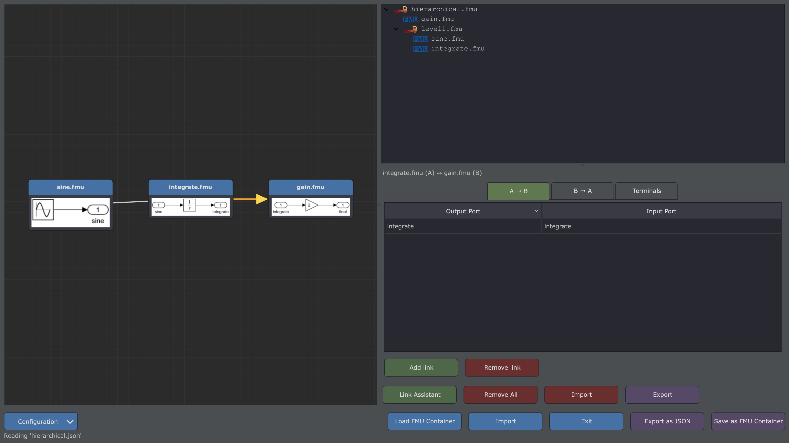

## Interface Overview

The interface is split into three main areas:

| Area | Description |
|---|---|
| **Node Graph** (left) | Visual canvas where FMU nodes and wires are displayed |
| **Tree View** (top-right) | Hierarchical structure of containers and FMUs |
| **Detail Panel** (bottom-right) | Properties of the selected node, wire, or container |
| **Button Bar** (bottom) | Configuration, load/save, and export actions |
| **Status Bar** (very bottom) | Last log message; click it to open the [log window](#log) |

## Node Graph

The node graph is the central workspace where you visually compose your FMU container.

### Adding FMU Nodes

There are three ways to add FMUs to the canvas:

- **Drag & Drop**: drag `.fmu` files from your file manager directly onto the canvas.
- **Right-click → Add FMU…**: opens a file dialog to select one or more `.fmu` files.
- **Tree View → Right-click → Add FMU…**: adds FMUs under a specific container in the hierarchy.

Each FMU node displays its name as a title: the filename of its FMU. The same FMU can be added several
times: each new node is an **instance** of it, named `<stem>-<n>.fmu` with the smallest free `n`
(`bb_position-1.fmu`, `bb_position-2.fmu`...); another file with an already used filename is named the same way.
The FMU detail panel of an instance shows the FMU it is an instance of. Wires, start values and exposed ports
belong to one node, and a saved JSON keeps the file of each instance (see
[Embedding the same FMU several times](container.md#embedding-the-same-fmu-several-times)).

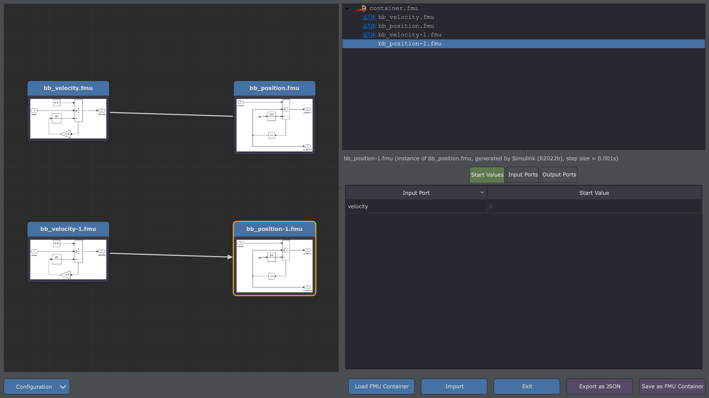

!!! note "Instances and automatic rules"
    The instances of an FMU are never linked by `auto_link`: wire them explicitly. When `auto_input` or
    `auto_output` exposes a port whose name is already used, it is exposed as `<fmu>.<port>`
    (e.g. `bb_position-1.position1`).

!!! note "Title bar color — Co-Simulation vs Model-Exchange"
    The color of a node's title bar reflects the FMI interface used to embed the FMU:

    - **Blue** — the FMU is embedded in **Co-Simulation** mode (default). FMUs advertising both
      Co-Simulation and Model-Exchange are also shown in blue, since Co-Simulation takes precedence.
    - **Green** — the FMU only provides **Model-Exchange** and is therefore integrated by the
      container's built-in solver (see [Model-Exchange support](container.md#model-exchange-support)).

    This lets you tell at a glance which embedded FMUs rely on the container's solver.

### Connecting FMUs with Wires

To create a connection between two FMUs:

1. Click and drag from the **body** of a node (below its title bar)
2. Release on another node
3. A wire is created between the two nodes

!!! tip "Title bar vs body"
    - **Title bar** (top strip with the FMU name): click to **select** or drag to **move** the node.
    - **Body** (area below the title bar): drag to **create a wire**.
    
    The cursor changes on hover to indicate the available action: ✥ for move, ✛ for wire creation.

Wires are **directional** — arrowheads indicate the data-flow direction:

- **Arrow on one end** → data flows in that direction (from one FMU to the other)
- **Arrows on both ends** → bidirectional connection (each FMU feeds the other)

The direction is determined by the port mappings configured in the [Wire Details](#wire-details)
panel.

### Reshaping Wires with Waypoints

Wires are drawn as straight-line segments. You can add **waypoints** to create broken lines
and route wires around nodes for better readability.

| Action | How |
|---|---|
| **Add a waypoint** | Double-click on a wire |
| **Move a waypoint** | Drag the blue handle (visible when the wire is selected) |
| **Remove a waypoint** | Double-click on a blue handle |

You can add as many waypoints as needed. The wire becomes a polyline passing through each
waypoint in order.

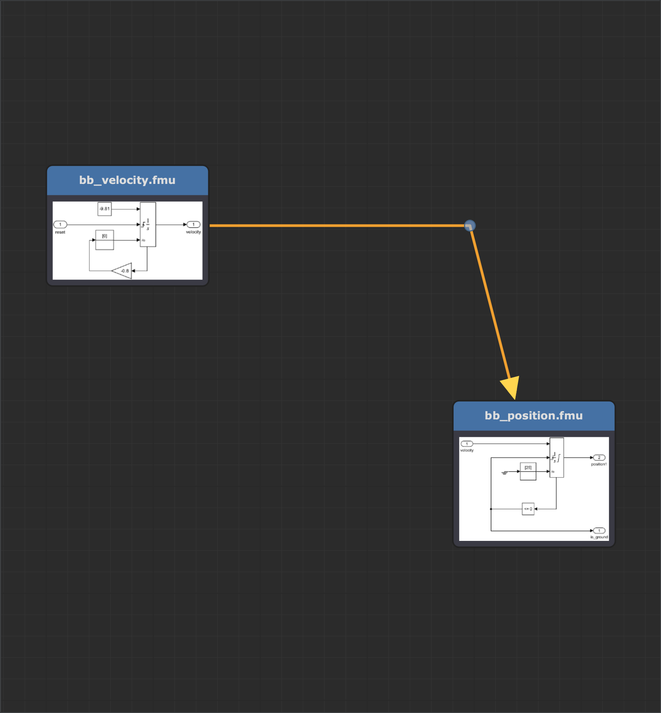

!!! tip "Visibility"
    Waypoint handles are only visible when the wire is **selected**. Click on a wire to
    select it and reveal its handles.

### Navigating the Canvas

| Action | How |
|---|---|
| **Pan** | Middle-click drag, or ++alt+left-button++ drag |
| **Zoom** | Mouse wheel |
| **Fit all** | Right-click → **Fit View** |
| **Select** | Left-click on a node or wire |
| **Multi-select** | Rubber-band selection (left-click drag on empty space) |
| **Move node** | Left-click drag on a node |
| **Delete** | Select items, then press ++delete++ or ++backspace++ |

### Context Menu (Right-click on Canvas)

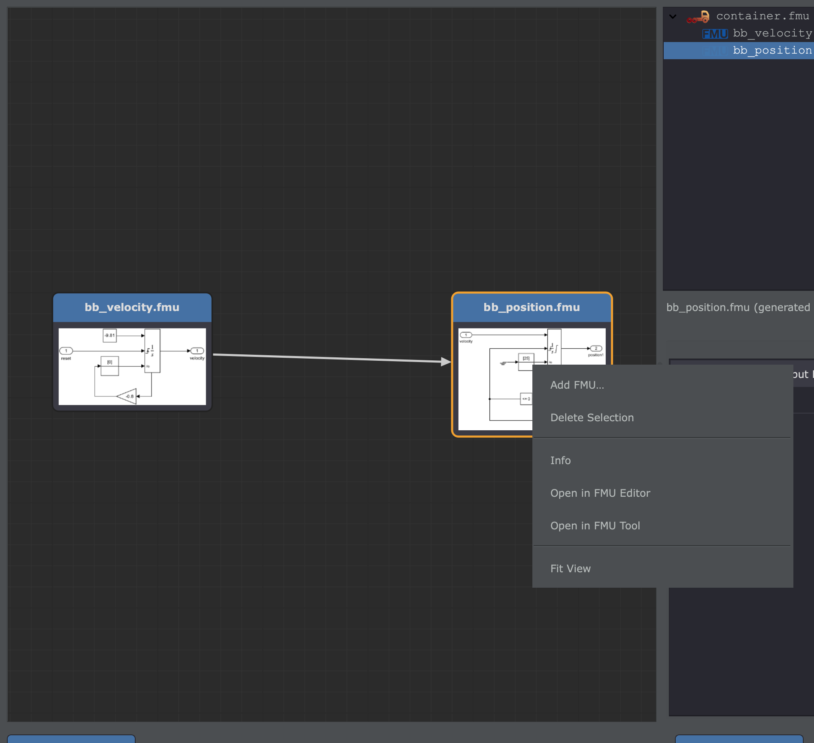

| Action | Description |
|---|---|
| **Add FMU…** | Open file dialog to add FMU nodes |
| **Delete Selection** | Remove selected nodes and wires |
| **Info** | Show node information and optionally replace the FMU file (single node only) |
| **Open in FMU Editor** | Open the selected FMU in the Variable Editor (single node only) |
| **Open in FMU Tool** | Open the selected FMU in FMU Tool (single node only) |
| **Fit View** | Zoom to fit all nodes in the viewport |

### Replacing an FMU

To replace an FMU with a different version or an alternative file:

1. Select the node, right-click and choose **Info**
2. The dialog shows the node name and current FMU file path
3. Click **Browse…** to select a new `.fmu` file
4. Click **OK** to apply the replacement

The replacement is done **in place**, for the selected node only, even when it is an instance of an FMU
added several times: all wires, start values, and exposed input/output ports are preserved. The node is renamed
after the new file (with the smallest free `-<n>` suffix if that name is used). If a port name referenced by a start value, a wire mapping, or an exposed input/output
no longer exists in the new FMU, it appears in **red** in the detail panels — allowing you to
review and correct invalid references. The affected wire itself is also drawn in **red** on the
canvas, so broken connections are immediately visible without having to open every wire's details.

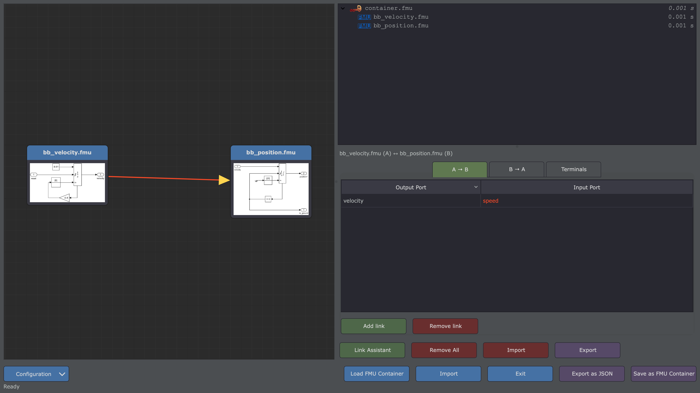

!!! tip "Typical use case"
    Use this feature when a new version of an FMU is available: replace the file and instantly
    see which connections or start values need updating.

## Tree View

The tree view shows the hierarchical structure of your container assembly.

### Root Container

The top-level item represents the output container FMU (default name: `container.fmu`).
All FMU nodes and sub-containers are children of this root.

### Sub-Containers

You can create nested containers to organize complex assemblies:

- **Right-click → Add Container**: creates a new sub-container under the selected item.
- **Rename**: right-click on a container → **Rename**.
- **Drag & Drop**: reorganize nodes and sub-containers by dragging them within the tree.

After renaming a container, the **Container Details** panel is refreshed immediately to reflect the new name.

### Context Menu (Right-click on Tree View)

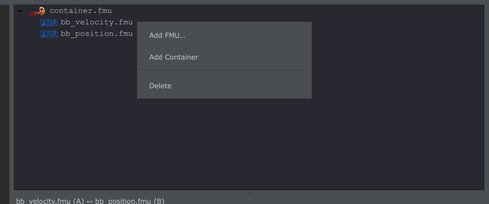

| Action | Description |
|---|---|
| **Add FMU…** | Add FMU nodes under the selected container |
| **Add Container** | Create a new sub-container |
| **Rename** | Rename a container |
| **Delete** | Remove a node or container (and all its contents) |

## Detail Panel

The detail panel shows the properties of the currently selected element.

### Node (FMU) Details

When an FMU node is selected, the detail panel shows:

- **FMU name**, generator tool, and step size
- Three tabs: **Start Values**, **Input Ports**, and **Output Ports**

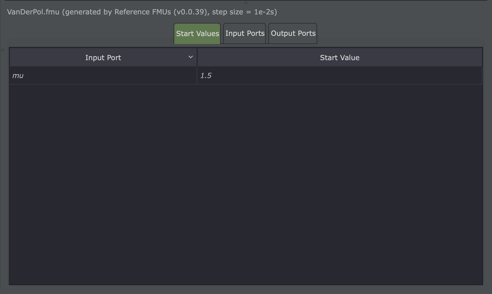

#### Start Values tab

Lists all input and parameter ports with their start values.

| Column | Description |
|---|---|
| **Input Port** | Port name (read-only). Clock and binary ports, as well as FMI-2 array aggregates, are excluded. |
| **Start Value** | User-defined start value (editable). A gray placeholder shows the FMU's default value. |

!!! tip "Start Values"
    Leave the start value empty to use the FMU's built-in default. Enter a value to override it
    in the container.

!!! note "FMI-2 array aggregates"
    Virtual array aggregates (see [Port Style Indicators](#port-style-indicators)) are **not**
    listed in this tab. Start values must be defined on the individual scalar elements
    (`myVector[1]`, `myVector[2]`, …), which appear as regular input ports.

#### Input Ports tab

Lists all input ports with a checkbox to explicitly expose them at the container level.

| Column | Description |
|---|---|
| **Input Port** | Port name (read-only) |
| **Exposed** | Checkbox — when checked, the port is exposed as an input of the container |

!!! tip "When to expose inputs"
    By default, `auto_input` automatically exposes unconnected input ports.
    Use this tab to explicitly select which inputs to expose — useful when `auto_input`
    is disabled, when the port is also driven by a wire but should remain overridable from
    outside the container, or when you need fine-grained control and want the assembly
    description to declare the input explicitly rather than relying on auto-wiring.

!!! note "Nested containers"
    When an FMU with an exposed input is nested inside a sub-container, the input is
    automatically propagated up through each parent container so that it remains reachable
    from the root container.

#### Output Ports tab

Lists all output ports with a checkbox to explicitly expose them at the container level.

| Column | Description |
|---|---|
| **Output Port** | Port name (read-only) |
| **Exposed** | Checkbox — when checked, the port is exposed as an output of the container |

!!! tip "When to expose outputs"
    By default, `auto_output` automatically exposes unconnected output ports.
    Use this tab to explicitly select which outputs to expose — useful when `auto_output`
    is disabled or when you need fine-grained control.

!!! note "Nested containers"
    When an FMU with an exposed output is nested inside a sub-container, the output is
    automatically propagated up through each parent container so that it remains reachable
    from the root container.

!!! note "Port Style Indicators"
    Ports are displayed with different text styles to indicate their nature:

    - **Parameter ports** are shown in *italics* — these are configuration values or tuning parameters.
    - **FMI-2 array aggregates** are shown in **bold** — these are virtual ports representing a
      family of scalar variables named `basename[k]` or `basename[i,j,...]` (Modelica-style
      comma notation) that the toolbox groups together so they can be connected as a single
      array to an FMI-3 array port.
    - When an aggregate is also a parameter, it is displayed in ***bold italics***.
    - Other port types (standard inputs/outputs) appear in regular text.

    This visual distinction helps you quickly identify parameters and array aggregates in the interface.


### Wire Details

When a wire is selected, the detail panel shows the **variable-level mappings** between the
two connected FMUs.

A header label identifies the two nodes: **A = *first FMU*,  B = *second FMU***.

The mappings are split into **three tabs**:

| Tab | Description |
|---|---|
| **A → B** | Output ports of A connected to input ports of B |
| **B → A** | Output ports of B connected to input ports of A |
| **Terminals** | Terminal-to-terminal connections (e.g. for [LS-BUS](ls-bus.md) enabled FMUs) |

Each tab contains a 2-column table:

| Column | Description |
|---|---|
| **Output Port** | Output variable of the source FMU (combo-box) |
| **Input Port** | Input variable of the destination FMU (combo-box) |

!!! note "Port Style Indicators"
    Ports are displayed with different text styles to indicate their nature:

    - **Parameter ports** are shown in *italics* — these are typically tuning parameters or configuration values.
    - **FMI-2 array aggregates** are shown in **bold** — virtual ports that group a family
      of scalar variables (e.g. `myVector[1]`, `myVector[2]`, `myVector[3]`) into a single
      array port. Selecting an aggregate on one side of a wire connects **all** its elements
      at once, which is especially useful for wiring FMI-2 arrays to FMI-3 array ports of
      matching shape.
    - When an aggregate is also a parameter, it is displayed in ***bold italics***.
    - Other ports (standard inputs, outputs) appear in regular text.

    This visual distinction helps you quickly identify parameters and array aggregates when
    configuring mappings.

Each tab has its own **Add link** / **Remove link** buttons to manage mappings for that direction.

!!! warning "Invalid connections shown in red"
    A wire is drawn in **red** on the canvas whenever at least one of its port mappings is
    invalid: either because the referenced port no longer exists on the FMU (e.g. after
    [Replace FMU](#replacing-an-fmu)), or because it targets an inactive
    [`configuration` node port](#the-configuration-node-ts_multiplier) (`ts_multiplier` unchecked).
    In both cases, the invalid port name is also shown in red inside the *Wire Details* table
    so you can quickly locate and fix (or simply understand) the broken mapping.

!!! tip "Direction indicator on the wire"
    While the *Wire Details* panel is open, a yellow indicator is overlaid on the selected wire
    to reflect the currently active tab:

    - **A → B** — an enlarged yellow arrowhead at the B extremity, pointing outward.
    - **B → A** — an enlarged yellow arrowhead at the A extremity, pointing outward.
    - **Terminals** — a divergent ◀▶ marker (two triangles pointing outward) at the middle of the wire.

    Switching tabs updates the indicator immediately, making it easy to see which side of the
    connection you are currently editing.

#### Terminals tab

The **Terminals** tab allows connecting FMU terminals (as defined in the FMI LS-BUS standard).
Each row maps a terminal from FMU A to a terminal from FMU B:

| Column | Description |
|---|---|
| **Terminal A** | Terminal name from FMU A (combo-box) |
| **Terminal B** | Terminal name from FMU B (combo-box) |

This tab is useful when working with [LS-BUS enabled FMUs](ls-bus.md) where communication
occurs through terminal connections rather than individual variable ports.

The arrowheads on the wire update automatically to reflect the configured directions.

Below the tabs, global buttons are available:

| Button | Description |
|---|---|
| **Link Assistant** | Open the [Link Assistant](#link-assistant) to define many links at once |
| **Remove All** | Remove all link definitions between A and B (both directions) |
| **Import** | Import link definitions from a CSV file |
| **Export** | Export link definitions to a CSV file |

!!! info "CSV Format for Import/Export"
    The CSV file uses 4 columns: `FMU From`, `Port From`, `FMU To`, `Port To`.
    Each row represents a single port-to-port connection, and both directions (A → B and B → A) 
    are included in the same file. This makes it easy to edit link definitions in a spreadsheet
    and re-import them.

#### Link Assistant

When the FMUs have hundreds of ports, filling the tables of the *Wire Details* panel one link at
a time is tedious. The **Link Assistant** button opens a window that proposes links in bulk, lets
you review them, and writes them into the wire only when you click **Apply**.

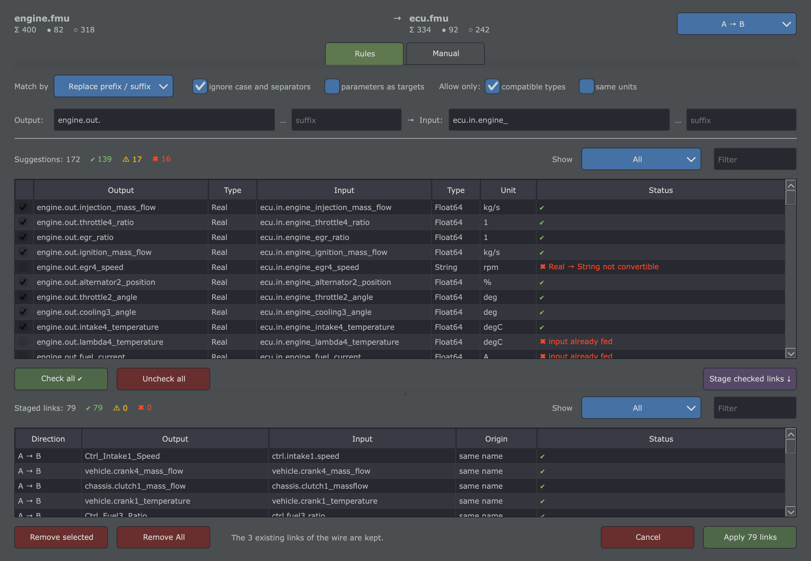

The window works on the wire that was selected when it was opened. It does not block the rest of
the Container Builder: you can keep looking at the graph. Clicking **Link Assistant** again brings
it to the front; on another wire, it closes the open assistant first (asking for confirmation if
links are staged there).

**Header** — the two FMUs in the order of the current direction (`source.fmu → target.fmu`). Below
each name, the counters of its ports:

| Symbol | Meaning |
|---|---|
| **Σ** | Total number of outputs (source) or inputs (target) |
| **●** | Outputs already linked on this wire, or inputs already fed: by a link of any wire of the FMU, by an exposed input, or by a staged link |
| **○** | Free ports |

The selector on the right switches the direction (**A → B** / **B → A**). The staged links of both
directions are kept, so both directions can be prepared before applying.

The window has two tabs, **Rules** and **Manual**, which share the list of
[staged links](#staged-links) at the bottom.

##### Rules tab

A *criterion* proposes, for each free output, the input it should be linked to. Choose it with
**Match by**:

| Criterion | Parameters | Example |
|---|---|---|
| **Same name** | — | `vehicle.speed` → `vehicle.speed` |
| **Replace prefix / suffix** | Prefix and suffix of the output name, replaced by those of the input name | `engine.out.speed` → `ecu.in.engine_speed` (`engine.out.` → `ecu.in.engine_`) |
| **Regular expression** | A regular expression matching the **whole** output name, and the input name built from its groups (`\1`, `\2`, …) | `^sensor\.(\w+)\.(\w+)$` → `sensor_\2_\1` |
| **Similar names** | Minimum similarity score (1.00 to 0.50) | `chassis.pressure` → `chassis.press` |

Options of the criterion:

| Option | Effect |
|---|---|
| **ignore case and separators** | Names are compared without case nor separators (`.` `_` `-` `[` `]`), for every criterion: `Throttle_Pos` matches `throttle.pos`. Checked by default |
| **parameters as targets** | Also propose the parameters of the target FMU, not only its inputs |
| **Allow only: compatible types** | Checked (default): a link between types without conversion is an error ✖. Unchecked: it is only a warning ⚠ |
| **Allow only: same units** | Checked: a link between different units is an error ✖. Unchecked (default): it is a warning ⚠ |

The suggestions are updated a moment after each change of the criterion, of its parameters or of
an option. Each one is checked when it can be applied, and gets a status:

| Status | Meaning |
|---|---|
| **✔** | The link can be applied |
| **⚠** | The link can be applied, but should be reviewed: lossy type conversion (e.g. `Real` → `Int32`), different units, or a name found by **Similar names** |
| **✖** | The link cannot be applied: the input is already fed, the types cannot be converted, the arrays have different sizes |

Review the suggestions (the **Show** selector and the **Filter** field narrow the table), then
click **Stage checked links ↓**; a double-click on a row stages that suggestion only.
**Check all** and **Uncheck all** act on the rows shown. The staged links leave the
suggestions; the other suggestions keep their check boxes. Then pick another criterion: it only
sees the ports still free.

!!! tip "Typical sequence"
    Start with **Same name**, stage; then **Replace prefix / suffix** or **Regular expression**
    for the families of signals named differently, stage; then **Similar names** for what is
    left, reviewing each suggestion; link the last ports in the **Manual** tab.

!!! note "Large FMUs"
    If a search takes more than 0.3 s (e.g. **Similar names** on FMUs with thousands of ports),
    the suggestions are no longer updated while typing: a **Run ▶** button appears to search
    again.

##### Manual tab

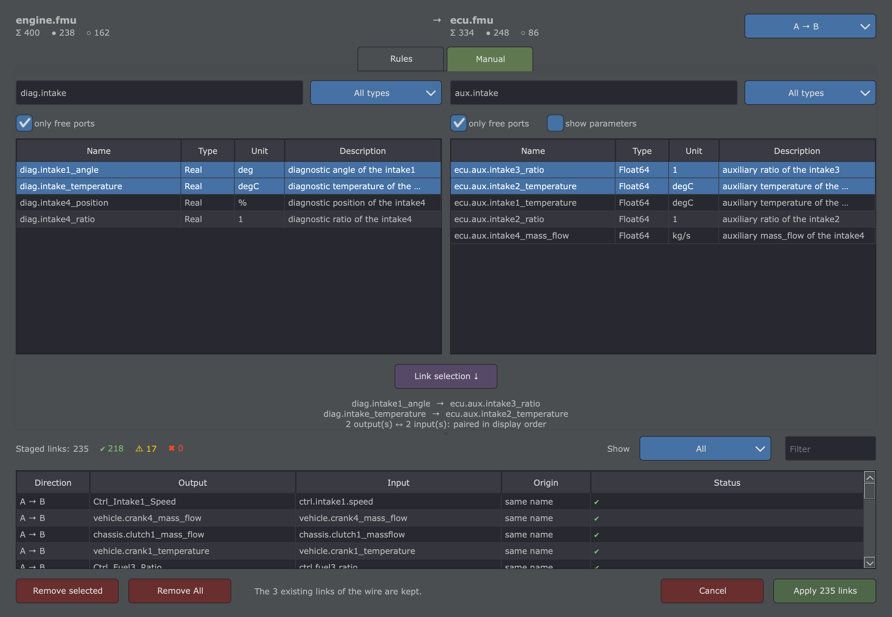

The outputs of the source FMU (left) and the inputs of the target FMU (right), each list below the
name of its FMU, with the type, unit and description of each port. Narrow them with the
**Filter** field (name or description) and the type selector; **only free ports** hides the ports
already linked, fed or staged; **show parameters** also lists the parameters of the target FMU.

Select ports in both lists (++shift++ / ++ctrl++ for several), check the preview below
**Link selection ↓**, and click it:

- as many outputs as inputs: they are paired in the order of the lists;
- one output and several inputs: the output feeds every selected input.

##### Staged links

The links staged by both tabs, with their direction, their origin (criterion or *manual*) and
their status. The status is computed again on each change: two staged links feeding the same input
are both ✖.

| Button | Description |
|---|---|
| **Remove selected** / **Remove All** | Remove staged links; their ports are free again and the suggestions of the **Rules** tab come back |
| **Cancel** | Close the window without changing the wire (asks for confirmation if links are staged) |
| **Apply *n* links** | Add the staged links to the wire, then close the window. Disabled while a link is ✖ |

The links already defined on the wire are kept. If an input was fed in the *Wire Details* panel
while the assistant was open, its staged link is not added (a message tells how many).

!!! note "FMI-2 arrays"
    An FMI-2 array aggregate and its elements (e.g. `u` and `u[1]`, `u[2]`) are one input for the
    assistant: staging one of them takes the others, and an aggregate is linked only to an array
    of the same size.

!!! info "Settings kept for the session"
    The parameters of each criterion and **ignore case and separators** are kept until the
    Container Builder is closed. The assistant always opens on **Same name**.

### Container Details

When a container is selected in the tree view, the detail panel shows its configuration parameters:

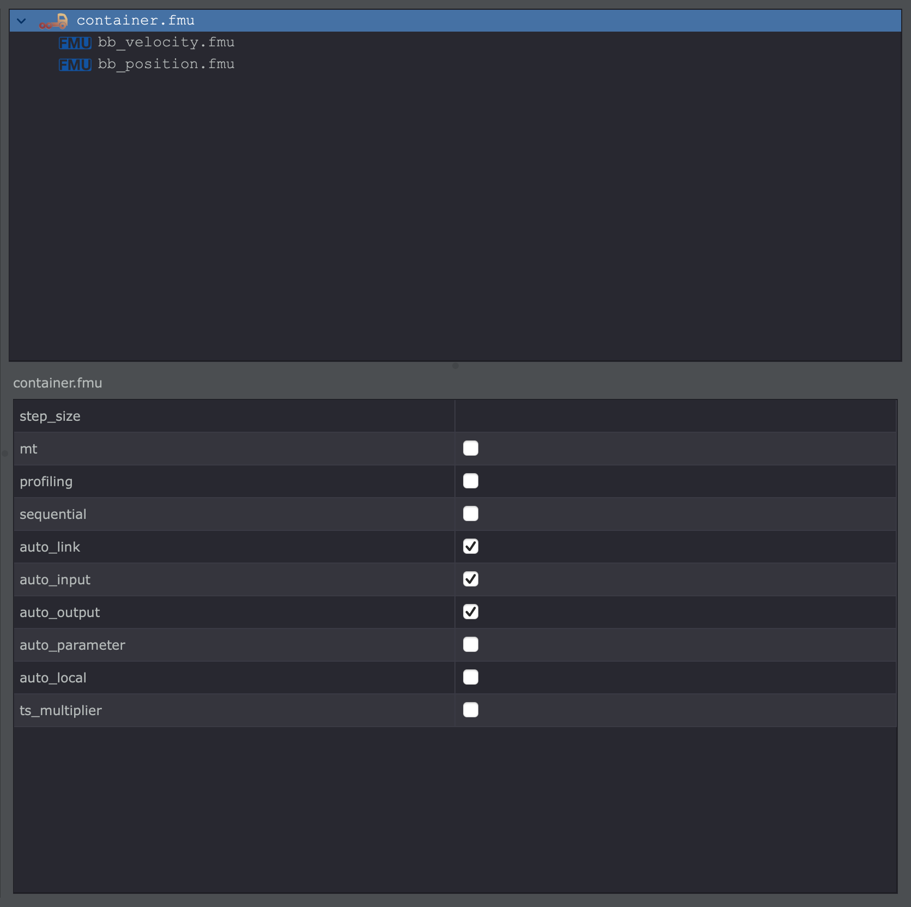

| Parameter | Type | Description |
|---|---|---|
| `step_size` | text | Fixed time step (in seconds) for the container's internal solver |
| `mt` | checkbox | Enable multi-threading (each FMU runs in its own thread) |
| `profiling` | checkbox | Enable performance profiling of embedded FMUs |
| `sequential` | checkbox | Force sequential execution order |
| `auto_link` | checkbox | Automatically link ports with matching names and types |
| `auto_input` | checkbox | Automatically expose unconnected input ports |
| `auto_output` | checkbox | Automatically expose unconnected output ports |
| `auto_parameter` | checkbox | Automatically expose parameter ports |
| `auto_local` | checkbox | Automatically expose local variables |
| `ts_multiplier` | checkbox | Add a `TS_MULTIPLIER` input for dynamic step size control |

### The `configuration` Node (`ts_multiplier`)

As soon as at least one **sub-container** (not the root container) has its `ts_multiplier`
parameter checked, a virtual node titled **configuration** automatically appears on the canvas.
This node is a **visual aid**: it does not correspond to any real FMU file, and it never gets its
own row in the tree view — it exists purely to help you keep track of which FMU drives the
`TS_MULTIPLIER` input of which sub-container.

- The node exposes **one input port per checked sub-container**, named
  `<container_name>.ts_multiplier` (the `.fmu` suffix of the container name is stripped).
- It can be wired from **any FMU** in the assembly, like a regular node — drag from the FMU's
  body onto the `configuration` node body to create the wire.
- It can be **moved** freely but **cannot be deleted** manually while it is still relevant.
- Selecting the `configuration` node shows an empty detail panel (there is nothing to configure
  on the node itself).
- Checking `ts_multiplier` on the **root** container has **no effect**: the root container is
  never added to the `configuration` node.

!!! important "This wire is a real link, not just a visual note"
    Unlike the `configuration` node itself (a pure GUI convenience), a wire connected to it **is**
    exported: it corresponds to a real link driving the target sub-container's reserved
    `container.ts_multiplier` runtime input (the actual input FMI port exposed by that container
    when `ts_multiplier` is enabled). When **importing** a JSON or FMU container, a link whose
    destination is a sub-container name with port `container.ts_multiplier` is automatically
    reconstructed as a wire to the `configuration` node's matching dynamic port. On **export**,
    the reverse translation is applied, so the round-trip is lossless.

!!! note "Unchecking `ts_multiplier`"
    Unchecking `ts_multiplier` on a sub-container does **not** delete its port nor an existing
    wire connected to it. Instead, the port becomes inactive and any wire referencing it is drawn
    in **red** (both on the canvas and in the *Wire Details* panel, see [Wire Details](#wire-details)),
    to flag the now-invalid connection. Re-checking `ts_multiplier` automatically restores the
    wire to a valid (non-red) state — no need to rewire.

!!! tip "Automatic cleanup"
    The `configuration` node is only removed from the canvas once **all** its ports are inactive
    **and** no wire (valid or invalid) references it anymore. This avoids losing your wiring setup
    when temporarily unchecking `ts_multiplier` on a container.

## Button Bar

### Configuration

Click **Configuration** to open a popup menu with:

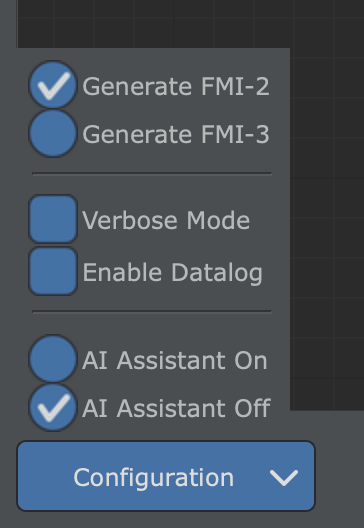

- **Generate FMI-2 / FMI-3**: choose the target FMI version for the output container.
- **Verbose Mode**: enable detailed logging (`DEBUG` messages in the [log window](#log), and a copy of every log
  message on the standard output of the terminal that launched the GUI) and keep intermediate build artifacts.
- **Enable Datalog**: include a `datalog.txt` configuration in the generated FMU (useful for simulation trace export).
- **AI Assistant On / Off**: start or stop the MCP server of the [AI Assistant](ai-assistant.md) (only when the
  `mcp` extra is installed).

### Actions

| Button | Description |
|---|---|
| **Load FMU Container** | Load an existing FMU container (splits it and reconstructs the graph) |
| **Import** | Import an assembly from a [JSON](container.md#json-input-file) or [CSV](container.md#csv-input-file) description file |
| **Export as JSON** | Export the assembly as a JSON description file |
| **Save as FMU Container** | Build and save the container as a `.fmu` file |
| **Exit** | Close the window (prompts if there are unsaved changes) |

During **Load**, **Import**, **Export**, and **Save** operations, a progress dialog shows execution logs in real time.
These messages also remain available in the [log window](#log).

!!! tip "Relative FMU paths"
    When exporting with **Export as JSON**, the FMU paths written in the `fmu` and `link` blocks
    are automatically made relative to the directory where the JSON file is saved. This keeps the
    exported assembly portable as long as the FMU files stay in the same relative layout — see
    also the [FMU location](#importing-an-assembly-file) requirement when re-importing.

## Log

Every component of the Container Builder (graph, tree, build, import, AI Assistant) writes to a single log.

### Status Bar

The status bar, under the button bar, shows the last message of level **Info** or above, in the colour of its level
(grey for information, yellow for warnings, red for errors). It stays until the next message. A message spanning
several lines is shown by its first line followed by `…`.

Click the status bar to open the log window.

### Log Window

The log window lists every message since the Container Builder was launched (the last 5000 ones). It is not modal:
it can stay open next to the main window and receives new messages as they arrive.

| Control | Description |
|---|---|
| **Level** (Debug / Info / Warning / Error) | Show only the messages of this level or above |
| **Search…** | Show only the messages containing this text (case-insensitive) |
| **Save Logs…** | Save the displayed messages in a text file |
| **Clear** | Forget all messages (they are not shown again when the window is reopened) |
| **Close** | Close the window; the log keeps being recorded |

!!! tip "Debug messages"
    `DEBUG` messages are only recorded while **Verbose Mode** is enabled (see [Configuration](#configuration)).

## Typical Workflow

### Step 1: Add FMUs

Drag and drop your `.fmu` files onto the canvas, or use the right-click menu.

### Step 2: Connect FMUs

Draw wires between output and input ports. Select a wire to configure the port-level mappings
in the detail panel. Use **Auto-connect** to speed up the process.

### Step 3: Configure the Container

Select the root container in the tree view to set the time step and other options
(multi-threading, profiling, auto-linking, etc.).

### Step 4: Organize Hierarchy (Optional)

Create sub-containers and drag FMUs into them to build nested assemblies.

### Step 5: Set Start Values and Expose Ports (Optional)

Select individual FMU nodes and override input port start values as needed.
Use the **Input Ports** tab to explicitly expose specific input ports, and the **Output Ports**
tab to explicitly expose specific output ports, at the container level.

### Step 6: Save

Click **Save as FMU Container** to build the final `.fmu` file, or **Export as JSON** to save
the assembly description for later use with the `fmucontainer` CLI.

## Auto-Wiring Workflow

If your FMUs share matching port names (e.g. the outputs of one FMU have the same names as the 
inputs of another), you can let the container build the connections automatically using the 
**auto_link** feature — without manually creating wires.

### Step 1: Import your FMUs

Drag and drop your `.fmu` files onto the canvas, or use the right-click menu to add them.
There is **no need** to draw wires manually between the FMUs.

### Step 2: Enable `auto_link`

Select the container in the tree view (the root item or a sub-container). In the **Container Details**
panel, make sure the `auto_link` checkbox is **checked** (it is enabled by default).

This tells the container to automatically connect ports with matching names when the FMU is built.

### Step 3: Save the FMU Container

Click **Save as FMU Container** to build the `.fmu` file. The auto-linking is performed during the
build process: matching output and input ports are connected automatically.

### Step 4: Reload to verify

Click **Load FMU Container** and open the `.fmu` file you just created. The tool will split the
container and reconstruct the graph — this time with all the **automatically created wires** visible 
on the canvas. You can select any wire to inspect the port mappings in the detail panel.

!!! tip "Combining manual and automatic wiring"
    Auto-linking and manual wires can coexist. Any explicit wire you create takes priority.
    The `auto_link` option will only fill in the remaining unconnected matching ports.

## Loading an Existing Container

Click **Load FMU Container** to open an existing `.fmu` container. The tool will:

1. Split the container to extract the embedded FMUs and the JSON description
2. Reconstruct the node graph with all FMUs, wires, port mappings, and start values
3. Restore container parameters (step size, multi-threading, etc.)

You can then modify the assembly and re-save it.

## Importing an Assembly File

Click **Import** to load an assembly from an existing description file. Two formats are supported:

- [**JSON**](container.md#json-input-file) — full assembly description including container parameters, FMU list, links, start values, and sub-containers.
- [**CSV**](container.md#csv-input-file) — routing table only (FMU list, links, inputs/outputs). Container parameters use defaults.

The tool will:

1. Parse the description file using the same engine as the `fmucontainer` CLI
2. Reconstruct the node graph with all FMUs, wires, port mappings, and start values
3. Restore container parameters (from JSON) or apply defaults (from CSV)

!!! important "FMU location"
    The `.fmu` files referenced in the description must be located in the **same directory**
    as the JSON or CSV file.

!!! warning "Unsaved Changes"
    If you have unsaved changes when closing the window or loading a new container, you will be
    prompted to confirm.
