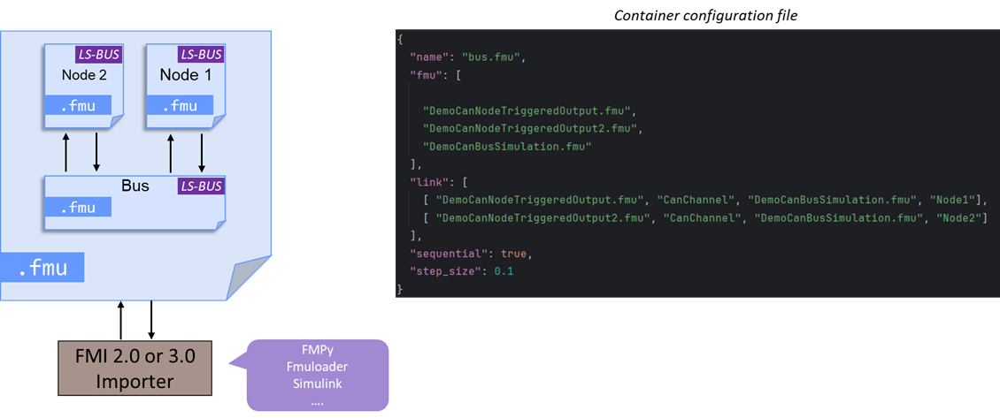

# Container with LS-BUS enabled FMUs




## What is supported

`fmucontainer` supports [FMI-LS-BUS](https://github.com/modelica/fmi-ls-bus) up to 1.3.0-rc.1, a release candidate: it may
still change until the final 1.3.0.

| Topic | Support |
|---|---|
| Buses | CAN, LIN, FlexRay and Ethernet: the bus operations are binaries that the container transports without reading them |
| Topologies | Nodes connected to a Bus Simulation FMU, or directly to each other |
| Container | It holds the **whole network**. It exposes no clock: a container cannot be connected as a node to a bus outside of it |
| Abstractions | Network Abstraction (`Tx_Data`, `Rx_Data`...) and Physical Signal Abstraction (signals in frame and PDU terminals) |

## Connecting terminals

A link between two terminals connects all their variables, those of their sub-terminals included.

A **nested terminal is designated by its full path**, with dots, for instance a port of an Ethernet segment:

```json
"link": [
  [ "node.fmu", "Eth", "bus.fmu", "Seg1.P1" ],
  [ "node.fmu", "Eth", "bus.fmu", "Seg2.P1" ]
]
```

!!! warning "Migration"
    A nested terminal designated by its bare name is refused, and the error gives its full path. Such an assembly was
    accepted by the previous versions, and two terminals of the same name overwrote each other without notice.

When a sub-terminal exists on one side only, the behaviour depends on the `matchingRule` of the terminals:

| `matchingRule` | Sub-terminal missing on one side |
|---|---|
| `bus` | Ignored, like the members of this rule |
| `plug`, `sequence` | Error |
| `org.fmi-ls-bus.transceiver` | Allowed for `Configuration`, error for any other |
| `none` (grouping terminals) | Error |

### Bus types and versions

The binaries of a link must have the same type of bus in their MIME type: a LIN node cannot be connected to a CAN bus, and
the build stops. Two versions of the same type of bus (for instance `1.0.0-beta.1` and `1.0.0`) give a warning. Binaries
that are not variables of LS-BUS are not concerned.

### Parameters of the Configuration terminal

The parameters of a `Configuration` terminal, such as `BusNotifications` or `DeliveryOnBoundary`, cannot be linked: they
are parameters. When the terminals of a node and of a Bus Simulation are connected:

- if the value of the Bus Simulation is known when the container is built (it has a `start`), it becomes the start value
  of the parameter of the node, unless you set one in the assembly;
- otherwise, a warning is issued: the parameter of the node keeps its default value. Set its start value yourself if
  needed.

## Clocks

The container acts as the importer of the embedded FMUs: it schedules their time-based input clocks, and shortens its steps
to reach their ticks.

| `intervalVariability` | Behaviour |
|---|---|
| `constant`, `fixed` | First tick after the shift, then at each interval. The interval and the shift come from the `modelDescription.xml`, or from the FMU if not declared. |
| `tunable` | The same, and the FMU may change the interval during the simulation |
| `changing`, `countdown` | The FMU announces each tick |
| `triggered` | Ticks with the clock it is linked to |

- Operations are exchanged in two super-dense time instants: the `Tx_Data` of all the FMUs are read, each FMU closes the instant with
  `fmi3UpdateDiscreteStates`, then `Rx_Clock` and `Rx_Data` are set. An FMU may evaluate its discrete states when its `Tx_Data` is read,
  and then refuse any input until this update: the FMUs of SystemDesk do so.
- A clock ticks at most once per time instant. An FMU that announces a new tick at the current time gets it after a very
  short step (twice the tolerance of the container).
- A `Rx_Clock` may be periodic (LS-BUS 1.3), but its ticks must match those of the clock of the sender. The container issues
  a warning when it cannot be sure: when the intervals or shifts it knows differ, or when it is driven by a `triggered` clock.
- Input clocks linked together without any time-based clock will never tick: a warning is issued.

## Checking an FMU

`fmutool -input my.fmu -check` also applies the rules of LS-BUS to an FMU that declares this layered standard: its manifest,
its terminals, the type, causality and clock of `Tx_Data`, `Rx_Data`, `Tx_Clock` and `Rx_Clock`, its MIME types.

## Analyzing the traffic

With the `-datalog` option, the container logs its variables in a CSV file. [`datalog2pcap`](../fmutool/cli-usage.md#datalog2pcap-convert-datalog-to-pcapng)
converts it for Wireshark.

## Step-by-step example

1. From [LS-BUS Examples](https://github.com/modelica/fmi-ls-bus-examples) build 2 nodes 
[`node1.fmu`](https://github.com/grouperenault/fmu_manipulation_toolbox/raw/refs/heads/main/tests/ls-bus/node1.fmu) and
[`node2.fmu`](https://github.com/grouperenault/fmu_manipulation_toolbox/raw/refs/heads/main/tests/ls-bus/node2.fmu))
and the Bus Simulation 
[`bus.fmu`](https://github.com/grouperenault/fmu_manipulation_toolbox/raw/refs/heads/main/tests/ls-bus/bus.fmu).

2. Create a `bus+nodes.json` file describing the container. In this example, it 
connects `node1.fmu` to `bus.fmu` through their terminals and the same for `node2.fmu`.
   ```json
       {
         "name": "bus+nodes.fmu",
         "fmu": [
           "bus.fmu",
           "node1.fmu",
           "node2.fmu"
         ],
         "link": [
           [ "node1.fmu", "CanChannel", "bus.fmu", "Node1"],
           [ "node2.fmu", "CanChannel", "bus.fmu", "Node2"]
         ],
         "step_size": 0.1
       }
   ```

3. Create the container with the following command line
   ```
   fmucontainer -container bus+nodes.json -fmi 3
   ```

4. You could run the `bus+nodes.fmu` with your favourite FMI-importer. Here is an example: 
    ```python
    from fmpy.simulation import simulate_fmu
    
    def log(*args):
        msg = args[-1]
        if isinstance(args[-1], bytes):
            msg = msg.decode('utf-8')
        print(f"{msg}")
    
    
    simulate_fmu("bus+nodes.fmu", step_size=0.1, stop_time=1,
                 output_interval=0.1, validate=True, use_event_mode=True,
                 logger=log, debug_logging=True, relative_tolerance=1e-6)
    ```

## Round-trip with `fmusplit`

Running [`fmusplit`](../fmutool/cli-usage.md#fmusplit-extract-fmus-from-a-container)
on the container `bus+nodes.fmu` produced above regenerates exactly the same
JSON assembly, with terminal-level `link` entries (e.g.
`[ "node1.fmu", "CanChannel", "bus.fmu", "Node1" ]`) rather than the underlying
per-signal port links. The extracted assembly can therefore be re-imported into
the GUI or rebuilt with `fmucontainer` without further editing.

