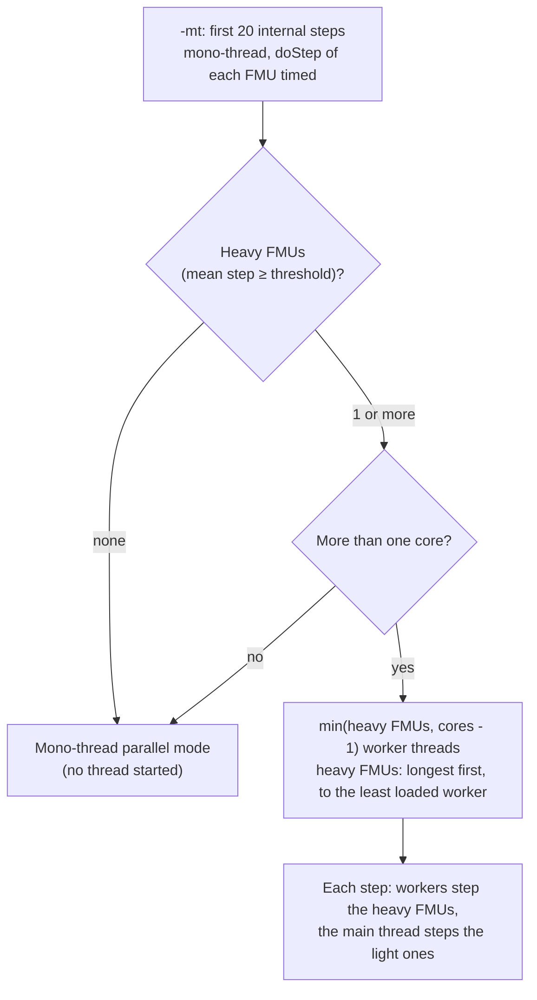
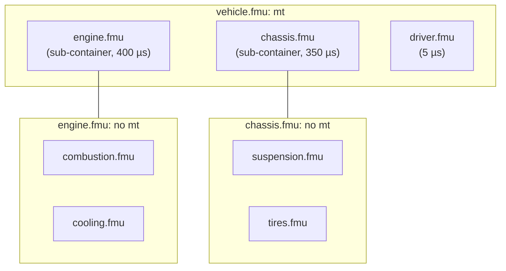

# Multi-Threading

The multi-threaded mode of a container (`-mt`) runs the steps of its embedded Co-Simulation FMUs in parallel, on
several threads. It shortens a simulation when some embedded FMUs have a long step; it brings nothing when all of them
are fast, and the container then simply does not use threads.

## In short

| Situation | Effect of `-mt` |
|---|---|
| At least two embedded FMUs with a long step (≥ the threshold, 50 µs by default) | **Faster**: their steps run at the same time, on worker threads |
| A single FMU with a long step | Small gain: its step overlaps the steps of the fast FMUs only |
| All the FMUs are fast | **No effect**: the container detects it and stays in the mono-thread mode |
| Nested containers | Enable `-mt` on **one level only**: the one whose FMUs are long |
| `-sequential` is also given | `-mt` is ignored: the sequential mode has no parallel step |

The results of the simulation are the same with and without `-mt`.

## How it works

At each internal step, a container in parallel mode (the default) sets the inputs of all its embedded FMUs, steps all
of them, then reads all their outputs: every FMU starts its step from the outputs of the others at the previous step.
The multi-threaded mode changes **who steps the FMUs**, not this order. The inputs and the outputs are always exchanged
by the main thread, before and after the steps, so the results do not depend on the threads.

1. **Warm-up**: during the first 20 internal steps, the container runs in the mono-thread parallel mode and measures
   the duration of the step (`doStep`) of each Co-Simulation FMU.
2. **Dispatch**: an FMU whose mean step takes at least the threshold is **heavy**, the others are **light**. The heavy
   FMUs are given to worker threads, at most as many as the cores minus one (the main thread keeps a core), the
   longest first, each to the least loaded worker.
3. **Steps**: the workers step the heavy FMUs while the main thread steps the light ones; the step of the container
   ends when all of them are done.



The decision is taken once, at the end of the warm-up, and logged, for example:

```text
Container uses the parallel mode with several threads, for the FMUs whose step takes 50 us or more (measured over the first 20 steps).
Container uses the parallel mode with several threads: 4 worker thread(s) for 4 FMU(s), 8 FMU(s) on the main thread.
FMU 'Slow-0.fmu' (step of 101.3 us) runs on the worker thread #0.
FMU 'Slow-1.fmu' (step of 100.8 us) runs on the worker thread #1.
...
```

or, when no FMU is heavy:

```text
Container uses the parallel mode with one thread: no FMU step takes the threshold.
```

## When it helps: several FMUs with a long step

Take a container with two heavy FMUs, `engine.fmu` (300 µs per step) and `gearbox.fmu` (200 µs), and two light ones,
`sensor.fmu` and `controller.fmu` (10 µs each). In the mono-thread mode, the steps follow each other: about 520 µs per
internal step. With `-mt`, the two heavy FMUs run on two workers while the main thread steps the light ones: the step
of the container lasts as long as the longest of them, about 300 µs.

```mermaid
gantt
    title One internal step (1 unit = 10 µs)
    dateFormat X
    axisFormat %s
    section Mono-thread
    engine.fmu      : 0, 30
    gearbox.fmu     : 30, 50
    sensor.fmu      : 50, 51
    controller.fmu  : 51, 52
    section mt main thread
    sensor.fmu      : 0, 1
    controller.fmu  : 1, 2
    section mt worker 0
    engine.fmu      : 0, 30
    section mt worker 1
    gearbox.fmu     : 0, 20
```



The step of the container is bounded by its **longest** FMU: two heavy FMUs of the same duration give the best gain,
a heavy FMU much longer than the others leaves the workers of the others idle. With more heavy FMUs than workers, a
worker steps several of them one after the other.

Measured on a laptop (Apple M4, 10 cores) with 8 light FMUs and 4 heavy ones of about 100 µs each, 2 500 internal
steps:

| Mode | Time of the simulation |
|---|---|
| Mono-thread (parallel) | 1.05 s |
| `-mt` | 0.36 s (2.9 times faster) |

With a **single** heavy FMU, its step only overlaps the steps of the light FMUs: the gain is at most their duration,
small when they are fast.

## When it does not help: all the FMUs are fast

Releasing the worker threads and waiting for them costs a few microseconds at each step. When all the FMUs step in a
few microseconds, running each of them on its own thread costs more than it saves: the simulation would be **slower**
than in the mono-thread mode. The container avoids it: after the warm-up, no FMU is heavy, no thread is started, and the
simulation goes on as without `-mt`.

```mermaid
gantt
    title One internal step of 20 fast FMUs (schematic, 1 unit = 1 µs)
    dateFormat X
    axisFormat %s
    section Mono-thread
    20 FMUs one after the other   : 0, 19
    section One thread per FMU (not used)
    release the threads           : 0, 8
    steps in parallel             : 8, 12
    wait for all the threads      : 12, 30
```



Measured with 20 fast FMUs (a few µs each), for the same simulation: 0.31 s in the mono-thread mode, 1.17 s with one
thread per FMU (the behaviour of `-mt` before 2.1), 0.31 s with the current `-mt`. Enabling `-mt` costs nothing, but
brings nothing either.

## Choosing the threshold

The default threshold, **50 µs**, is far above the cost of the synchronization of the threads (a few µs): an FMU above
it is worth a thread. It can be changed:

| Where | How |
|---|---|
| Command line | `fmucontainer -container assembly.json -mt -mt-threshold 0.0002` (seconds) |
| JSON description | `"mt": true, "mt_threshold": 0.0002` |
| Container Builder | `mt` and `mt_threshold` in the parameters of the container |
| AI Assistant | `set_container_options` with `mt` and `mt_threshold` |
| Python API | `container.make_fmu("assembly.fmu", mt=True, mt_threshold=0.0002)`, or `AssemblyNode(..., mt=True, mt_threshold=0.0002)` |

- `0` gives a thread to every Co-Simulation FMU (within the number of cores).
- The log lists the heavy FMUs with the duration of their step: a good starting point to adjust the threshold. The
  [profiling](container.md#profiling) (`-profile`) gives the real-time ratio of each FMU over the whole simulation.
- The steps are measured during the first 20 internal steps only: an FMU whose step is long at the start only (an
  initialization) or late only may be classified on this short sample.

## Nested containers

A sub-container is, for its parent, one embedded FMU: its step contains the steps of all its own FMUs. With `-mt`, the
parent measures it as any FMU, and gives it a worker if it is heavy.

Each container that has `mt` keeps **its own** pool of workers, sized for the whole machine (cores - 1). Enabling
`mt` on a container and on one of its sub-containers runs both pools at the same time, with more threads than cores:
the threads wait for each other and the gain is lost. Enable `mt` on **one level only**, the one whose FMUs have long
steps:



Here, the two sub-containers are the heavy FMUs of `vehicle.fmu`: they run on two workers, and each of them steps its
own FMUs on its thread.

```json
{
  "name": "vehicle.fmu",
  "mt": true,
  "fmu": ["driver.fmu"],
  "container": [
    {"name": "engine.fmu", "fmu": ["combustion.fmu", "cooling.fmu"]},
    {"name": "chassis.fmu", "fmu": ["suspension.fmu", "tires.fmu"]}
  ]
}
```

When the long FMUs are all in one sub-container (and its siblings are fast), enable `mt` on that sub-container instead.
The [AI Assistant](ai-assistant.md) warns about `mt` enabled on a container and on one of its ancestors (`nested-mt`).

## Limitations

- Only the Co-Simulation FMUs are stepped by the workers: the Model-Exchange FMUs are integrated together by the main
  thread, after the steps of the Co-Simulation FMUs.
- The inputs and the outputs of the FMUs are exchanged by the main thread: an FMU whose exchanges are slow (many
  ports, a remote FMU) does not get them in parallel.
- `-mt` needs at least two embedded FMUs; with `-sequential`, it is ignored.
- The dispatch is decided once, at the end of the warm-up, and kept until the end of the simulation, also after a
  reset of the container (`fmi2Reset` / `fmi3Reset`): there is no new warm-up.
