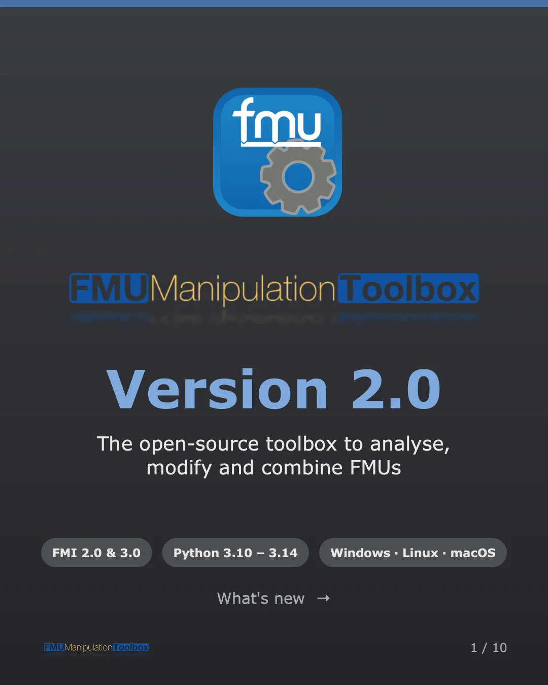
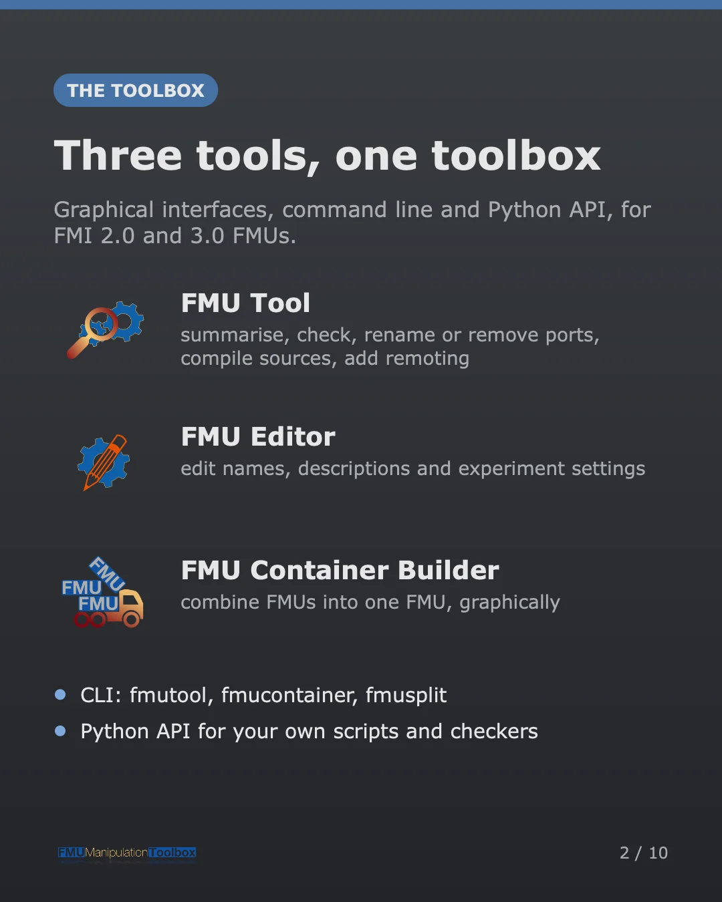
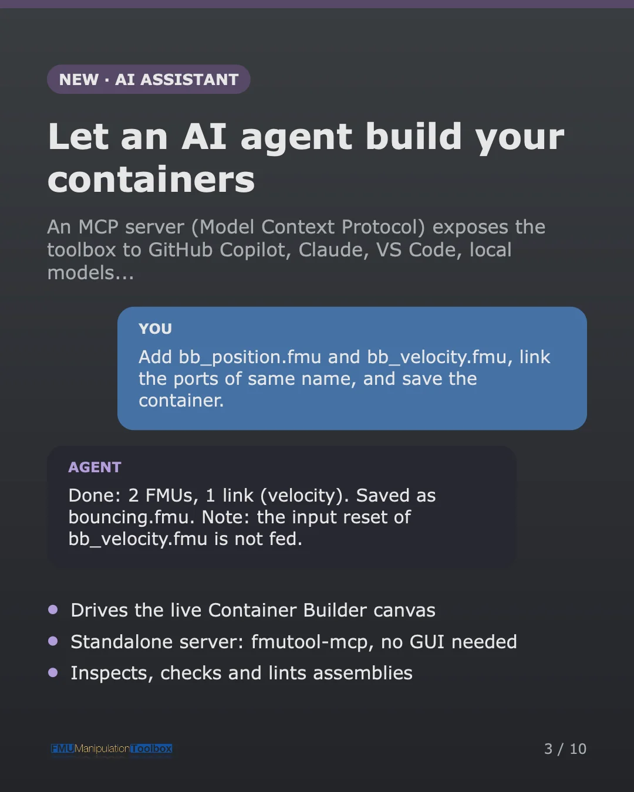
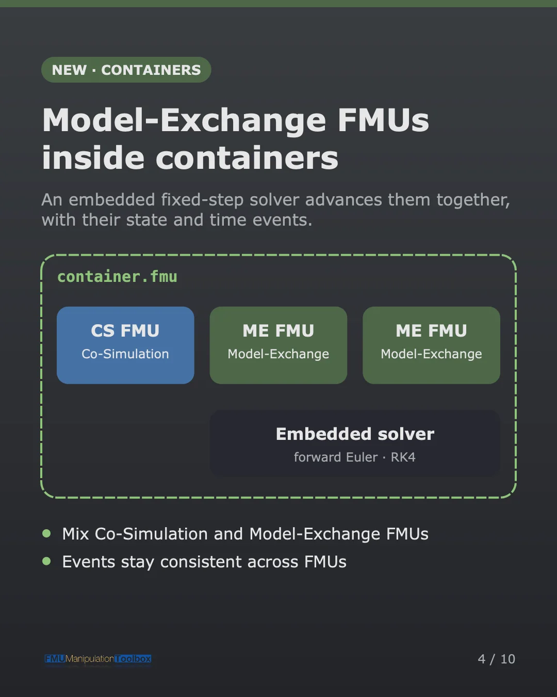
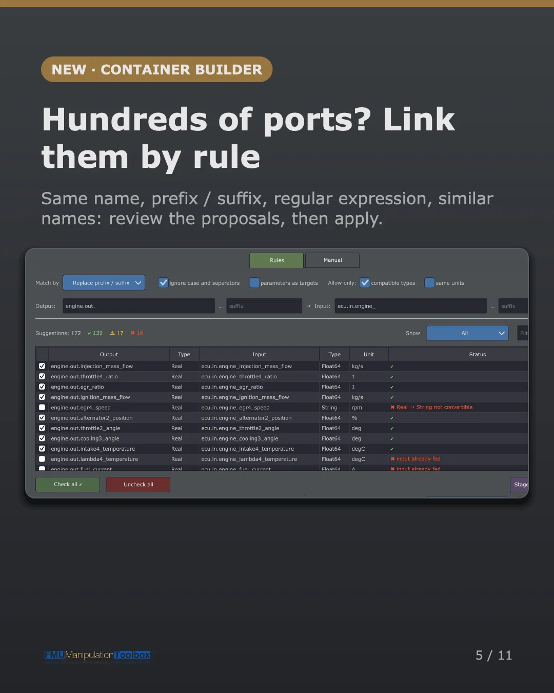
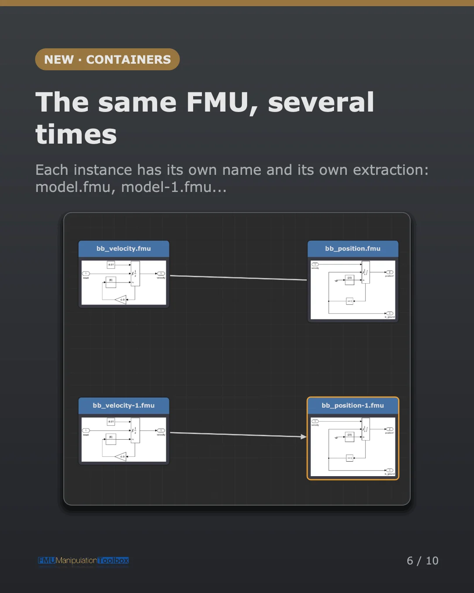
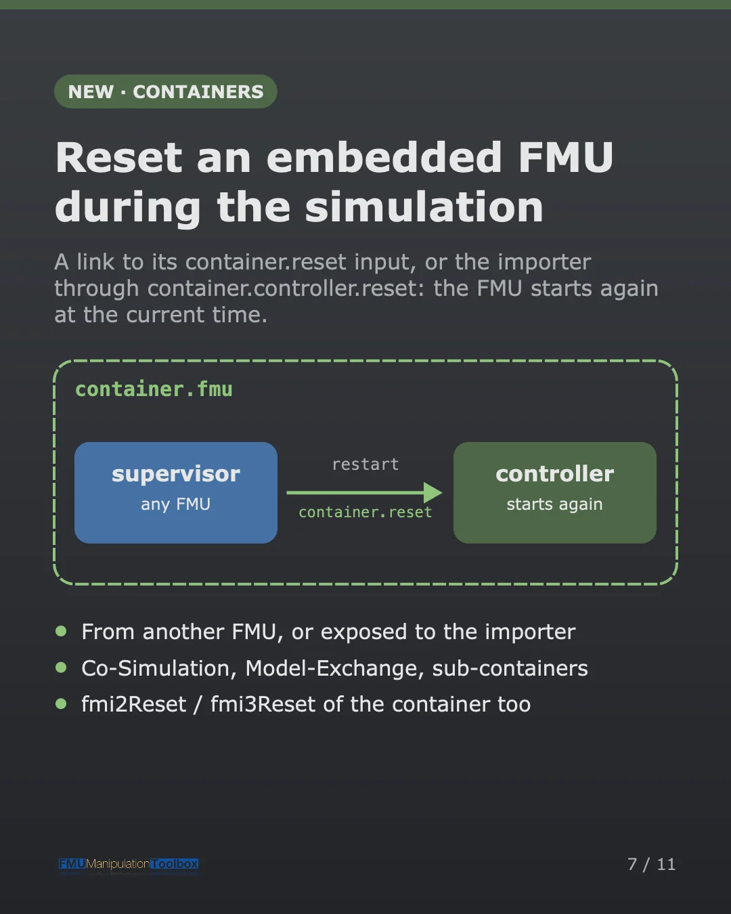
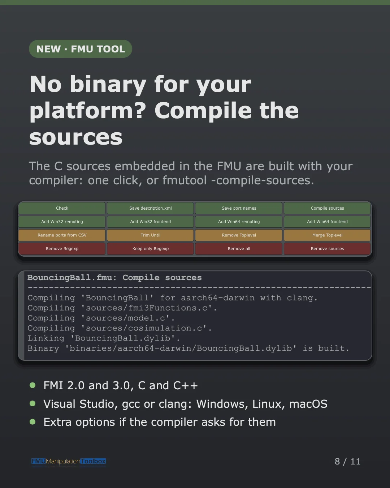
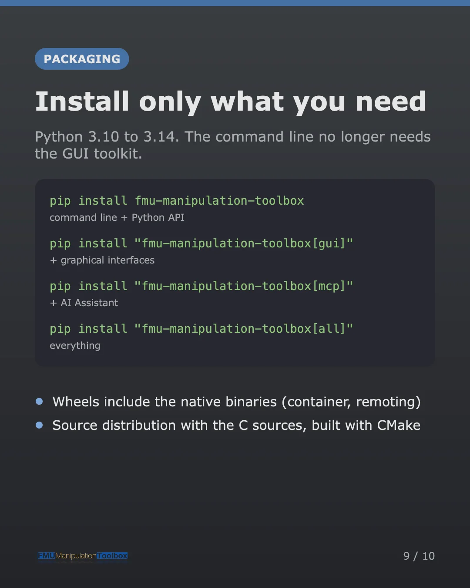
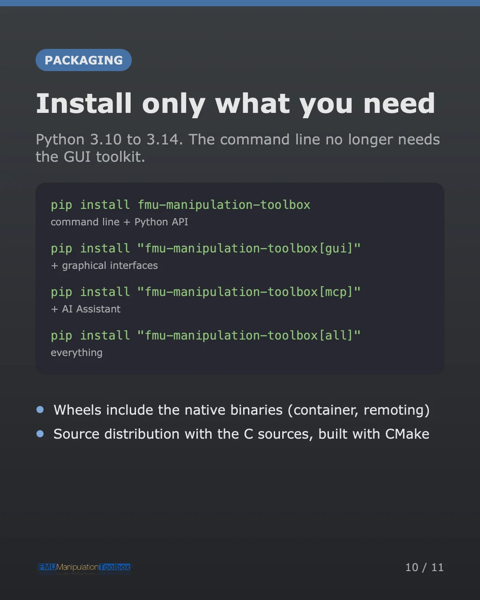

# What's new in 2.0

Version 2.0 is the biggest release of FMU Manipulation Toolbox so far.

<div class="carousel" markdown>
<div class="carousel-track" markdown>



{ loading=lazy }

{ loading=lazy }

{ loading=lazy }

{ loading=lazy }

{ loading=lazy }

{ loading=lazy }

{ loading=lazy }

{ loading=lazy }

{ loading=lazy }

</div>
</div>

## Highlights

- :material-robot: **AI Assistant** — an [MCP server](user-guide/fmucontainer/ai-assistant.md) lets an AI agent
  (GitHub Copilot, Claude, local models…) inspect FMUs and build containers, in the Container Builder or standalone
  (`fmutool-mcp`).
- :material-cog-sync: **Model-Exchange FMUs in containers** — they are [advanced by an embedded fixed-step
  solver](user-guide/fmucontainer/container.md#model-exchange-support), and can be mixed with Co-Simulation FMUs.
- :material-content-duplicate: **Several instances of the same FMU** in one container, each with
  [its own name](user-guide/fmucontainer/container.md#embedding-the-same-fmu-several-times).
- :material-link-variant: **Link Assistant** — [connect FMUs with hundreds of ports by
  rule](user-guide/fmucontainer/gui-usage.md#link-assistant): same name, prefix or suffix, regular expression,
  similar names; review the proposals, then apply.
- :material-hammer-wrench: **Compilation of the sources** — no binary for your platform? FMU Tool
  [compiles the C sources](user-guide/fmutool/cli-usage.md#compile-sources) embedded in the FMU.
- :material-shield-check: **Safer edits, stricter checks** — `modelDescription.xml` is edited in place, a
  [semantic checker](user-guide/fmutool/checker.md) verifies the rules of FMI 2.0 and 3.0, and the exit codes suit
  continuous integration.
- :material-language-python: **Python 3.10 to 3.14**, and a command line that no longer needs the GUI toolkit.

```bash
pip install "fmu-manipulation-toolbox[gui]"
```

See the [Installation Guide](installation.md) for the other extras.

!!! warning "Breaking changes"
    2.0 contains breaking changes, marked 🔴 **BREAKING** in the changelog: read them before updating your
    scripts, custom operations or checkers.

The full list of changes is in the
[changelog](https://github.com/grouperenault/fmu_manipulation_toolbox/blob/main/CHANGELOG.md){:target="_blank"}.
