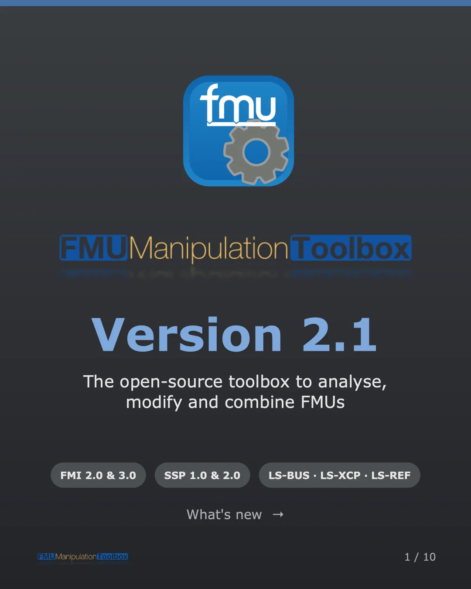
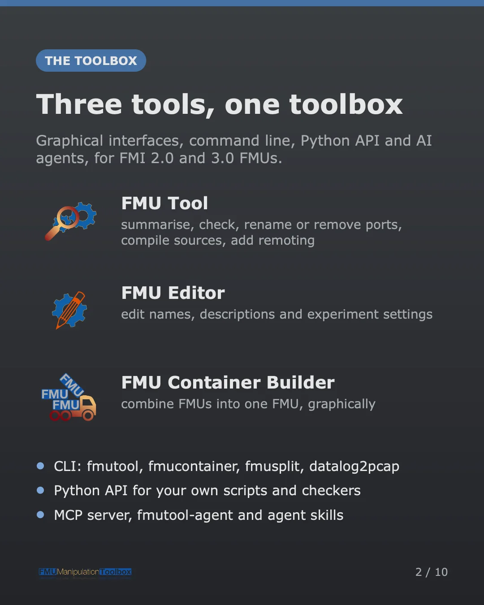
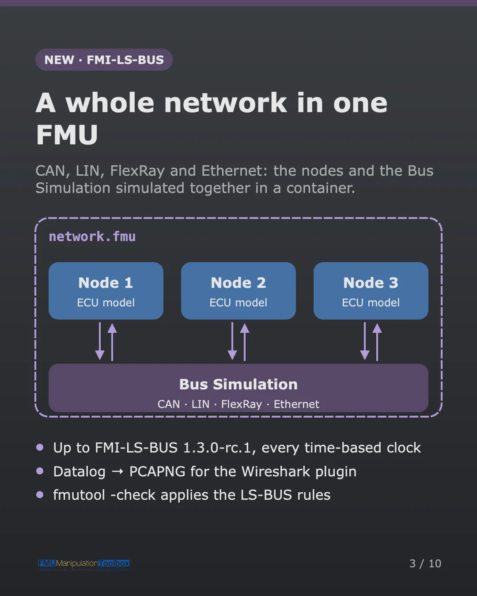
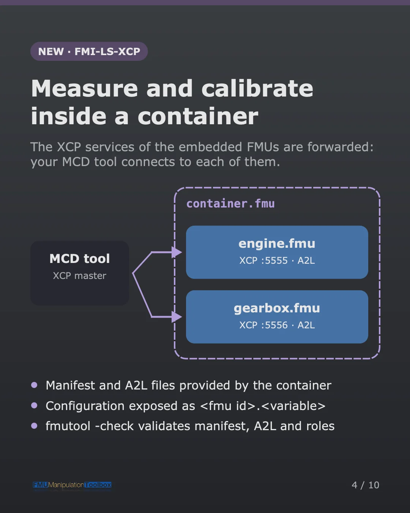
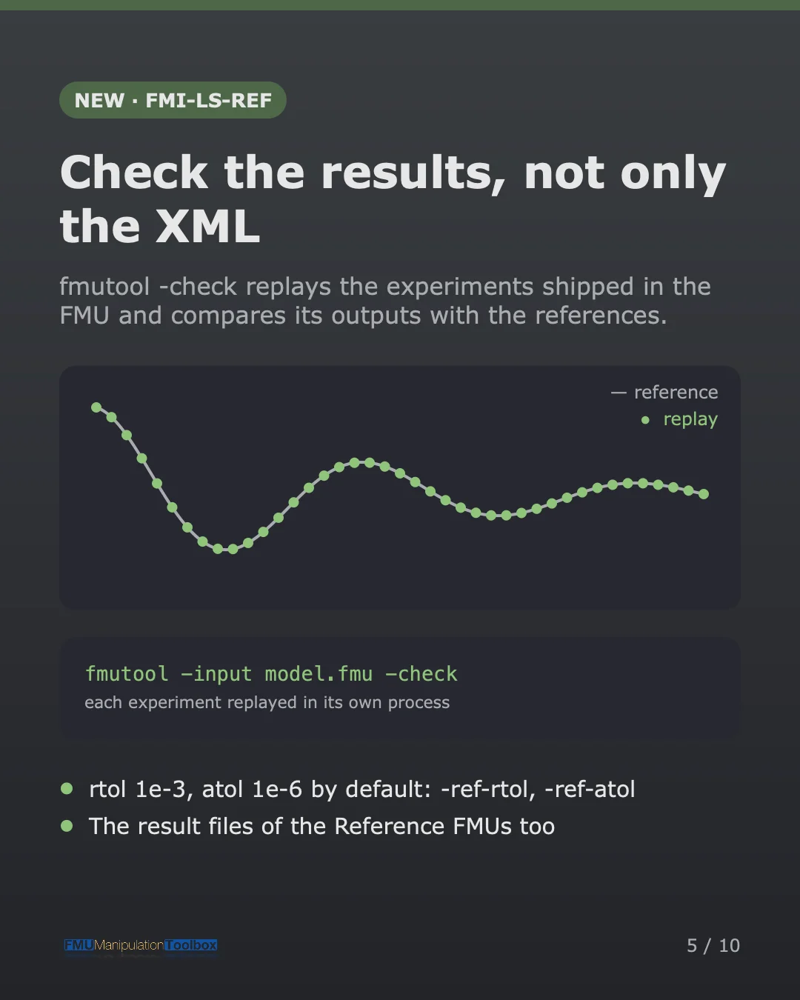
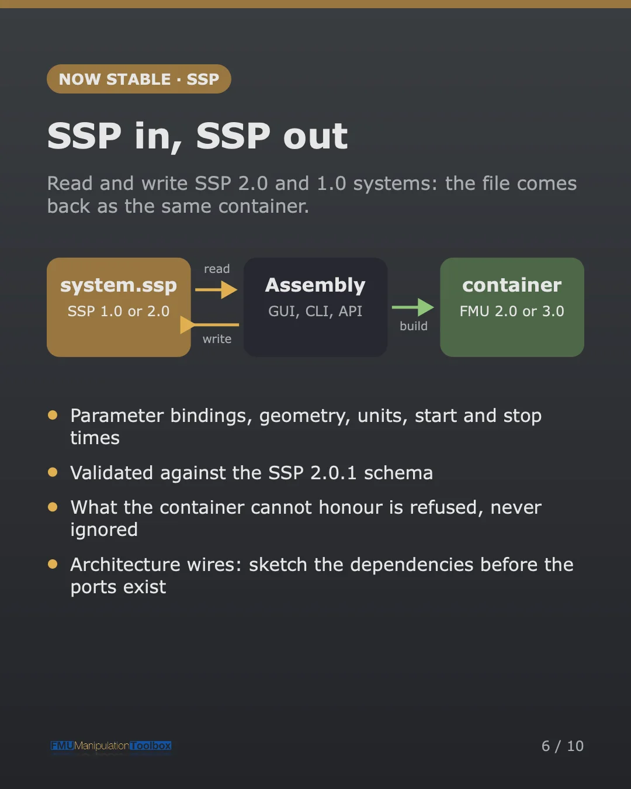
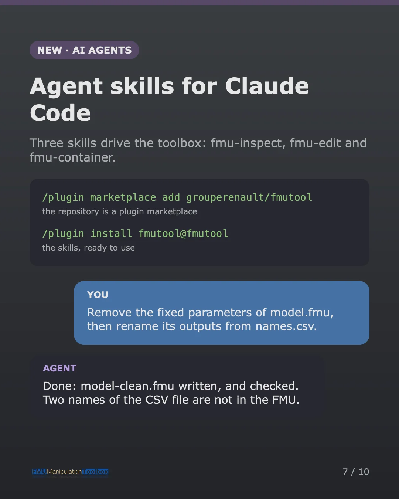
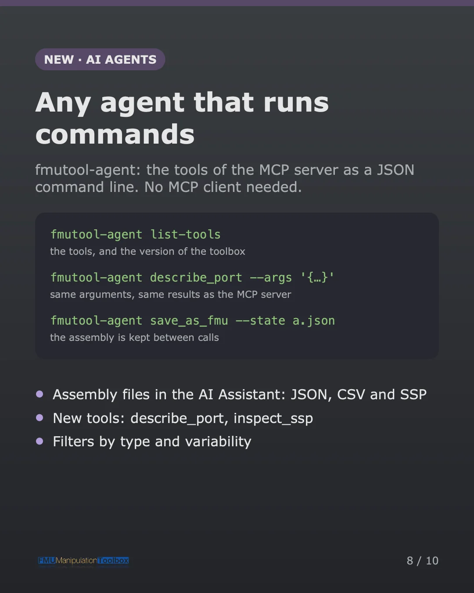
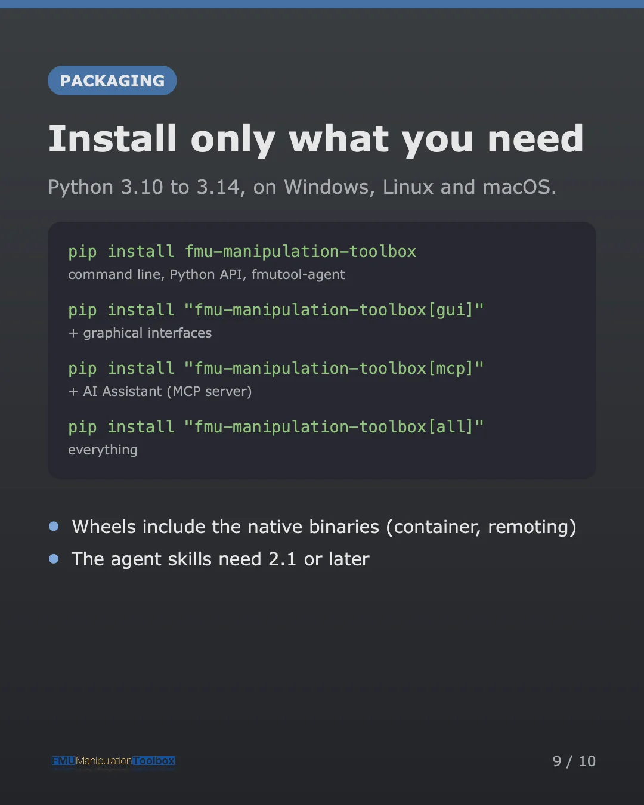
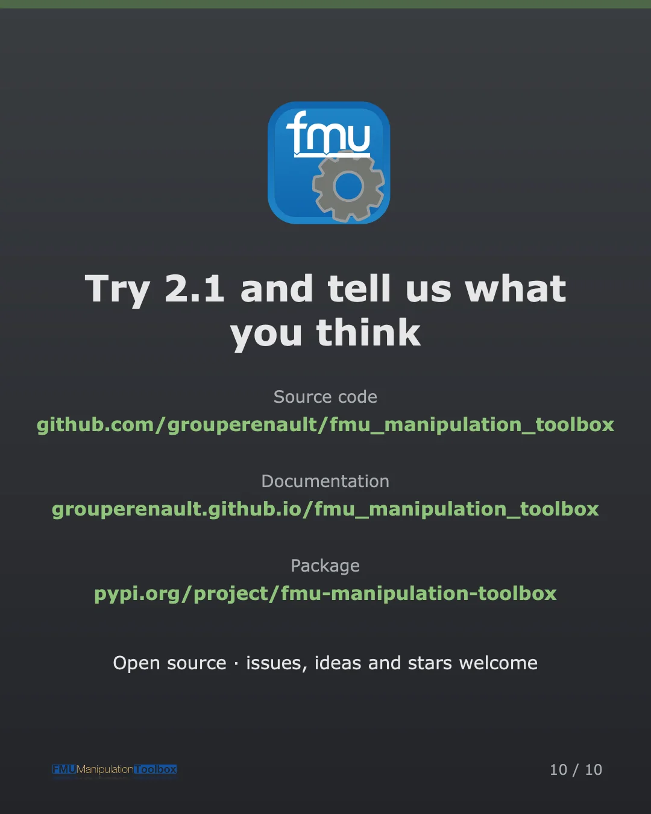

# What's new in 2.1

Version 2.1 brings the toolbox to maturity: the layered standards of FMI in containers and in the checker, SSP
declared stable and written as well as read, and AI agents beyond the MCP server.

<div class="carousel" markdown>
<div class="carousel-track" markdown>



{ loading=lazy }

{ loading=lazy }

{ loading=lazy }

{ loading=lazy }

{ loading=lazy }

{ loading=lazy }

{ loading=lazy }

{ loading=lazy }

{ loading=lazy }

</div>
</div>

## Highlights

- :material-lan: **FMI-LS-BUS** — a container holds [a whole network](user-guide/fmucontainer/ls-bus.md): CAN, LIN,
  FlexRay and Ethernet, up to FMI-LS-BUS 1.3.0-rc.1, with every time-based clock of FMI 3.0. `datalog2pcap` writes
  PCAPNG files for the Wireshark plugin of FMI-LS-BUS, and `fmutool -check` applies the rules of the standard.
- :material-tune-variant: **FMI-LS-XCP** — the [XCP services of the embedded FMUs are
  forwarded](user-guide/fmucontainer/ls-xcp.md) by the container: manifest and A2L files provided, configuration
  variables exposed. `fmutool -check` validates the manifest, the A2L files and the role variables.
- :material-chart-bell-curve-cumulative: **FMI-LS-REF** — `fmutool -check`
  [replays the experiments](user-guide/fmutool/checker.md#validation-of-the-results-fmi-ls-ref) shipped in an FMU,
  and the result files of the Reference FMUs, and compares the outputs with the references. Each experiment runs in
  its own process: a crash or a timeout fails this experiment only.
- :material-swap-horizontal-bold: **SSP is stable** — [SSP files are read](user-guide/fmucontainer/container.md#ssp-input-file)
  with their parameter bindings, geometry and start and stop times, validated against the SSP 2.0.1 schema, and
  [written](user-guide/fmucontainer/container.md#ssp-export) by `fmucontainer -dump-ssp`, `Assembly.write_ssp()` or
  the Container Builder: the file comes back as the same container. What the container cannot honour is refused,
  never ignored. [Architecture wires](user-guide/fmucontainer/container.md#architecture-wires) sketch the
  dependencies between components before their ports are known.
- :material-robot-happy: **AI agents** — [agent skills](user-guide/agent-skills.md) for Claude Code (`fmu-inspect`,
  `fmu-edit`, `fmu-container`), and `fmutool-agent`, the tools of the MCP server as a JSON command line for the agents
  that only run commands. The AI Assistant [loads and saves assembly
  files](user-guide/fmucontainer/ai-assistant.md#assembly-files) (JSON, CSV, SSP) and gets new tools
  (`describe_port`, `inspect_ssp`, filters by type and variability).

## Also in 2.1

- **Container runtime**: a pool of threads for the FMUs whose step is long, only
  ([Multi-Threading](user-guide/fmucontainer/multi-threading.md), option `-mt-threshold`); the values set on the
  container are given to the embedded FMUs when they need them; an embedded FMU can
  [terminate the simulation](user-guide/fmucontainer/container.md#termination-requested-by-an-embedded-fmu); a
  structural parameter of an embedded FMU can be exposed; an FMI 3.0 container declares its `fixedInternalStepSize`;
  many fixes of the clocks, of the datalog and of the resource locations.
- **FMU Tool**: options `-only-type` and `-only-variability`; in the GUI, **Selected Check** and **Advanced Compile**
  with Option (macOS) or Alt (Windows, Linux), and buttons enabled only when they can act.
- **Container Builder**: **Load** and **Save** for every format (FMU container, JSON, CSV, SSP), the step size of each
  FMU and container in the tree, the nodes of an SSP file placed after its geometry.
- **Native code**: one CMake project and CMake presets for every platform.

```bash
pip install --upgrade "fmu-manipulation-toolbox[gui]"
```

See the [Installation Guide](installation.md) for the other extras.

!!! warning "Breaking changes"
    2.1 contains breaking changes, marked 🔴 **BREAKING** in the changelog:

    - the datalog follows the locale of the simulation tool (with a decimal comma, a semicolon separates the
      columns);
    - a nested terminal is designated by its full path in a link (`Seg1.P1`);
    - `datalog2pcap` writes PCAPNG, its option `-can` is removed;
    - SSP files the container would build wrong are refused; `SSDParser` moved to `fmu_manipulation_toolbox.ssp`;
    - MCP tools and `fmutool-agent`: `save_assembly` replaces `save_as_json`, `add_links` replaces `add_link`,
      `rename_ports` replaces `rename_ports_from_csv`;
    - the `container/` and `remoting/` CMake projects are built by the root project only.

The full list of changes is in the
[changelog](https://github.com/grouperenault/fmu_manipulation_toolbox/blob/main/CHANGELOG.md){:target="_blank"}.
The previous version is described in [What's new in 2.0](whats-new-2.0.md).
